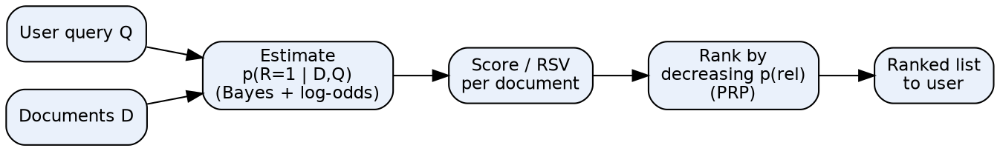
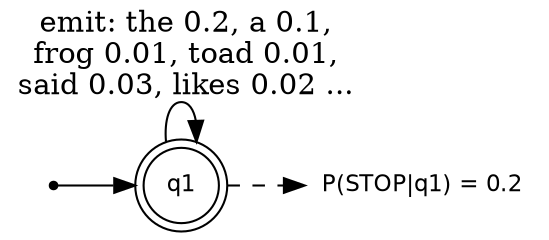
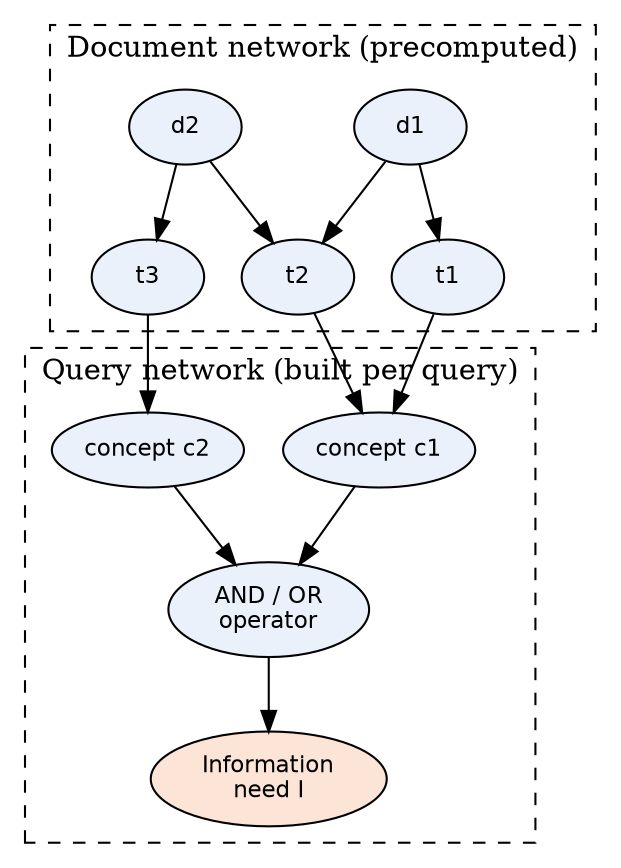
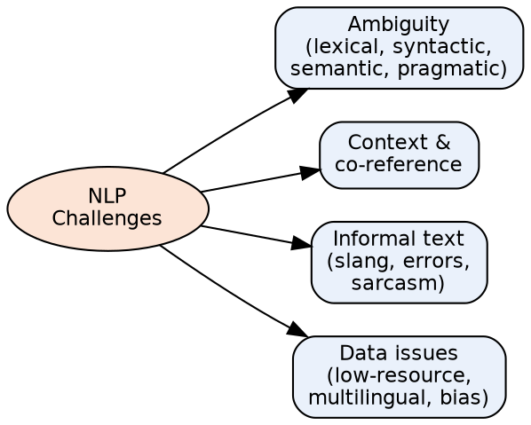
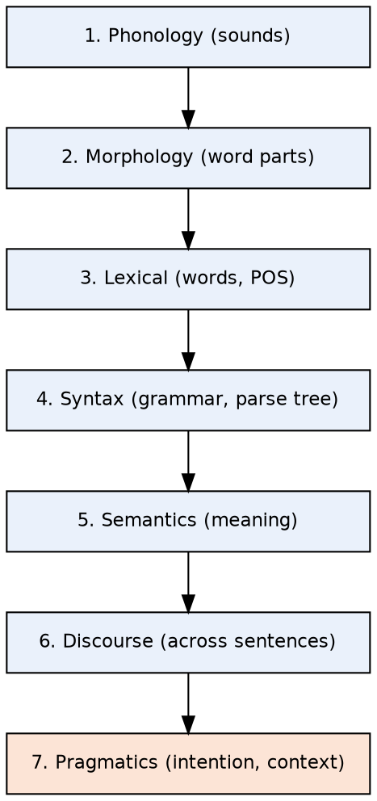
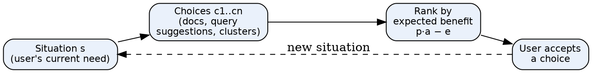
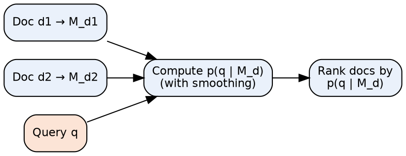
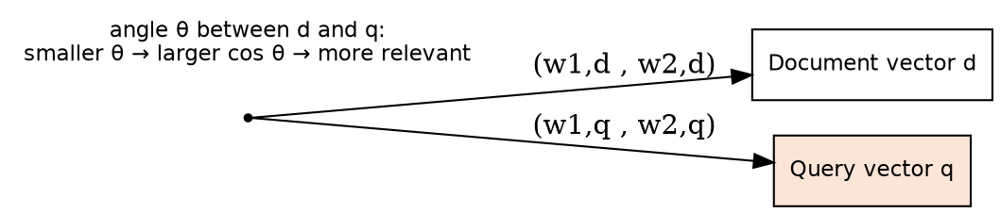
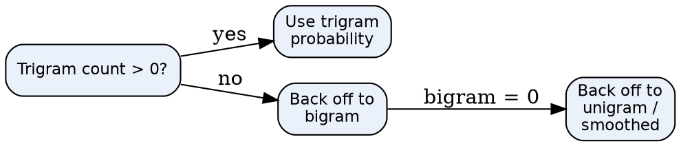

# Unit Snapshot

| No. | Question | Max Marks | Years Asked | Importance |
|---|---|---|---|---|
| 1.1 | Define and explain Probabilistic Retrieval | 6 | N23, M24, N24, N25 | ★★★ |
| 1.2 | Binary Independence Retrieval (BIR) model | 6 | N23, M24, N24, N25 | ★★★ |
| 1.3 | Explain language models / types of language models | 6 | N23, N24, N25 | ★★★ |
| 1.4 | Types of Bayesian networks | 6 | N23, N24, N25 | ★★★ |
| 1.5 | Challenges in Natural Language Processing | 6 | M24, N24, N25 | ★★★ |
| 1.6 | Levels of NLP with example | 6 | M24, N24, N25 | ★★★ |
| 1.7 | Probability Ranking Principle for interactive IR | 6 | N23 | ★ |
| 1.8 | Language modeling approach to IR | 6 | N23 | ★ |
| 1.9 | Define VSM, Term Frequency, Inverse Document Frequency | 6 | M24 | ★ |
| 1.10 | Problems with n-grams and how they are handled | 6 | M24 | ★ |

N23 = Nov–Dec 2023, M24 = May–Jun 2024, N24 = Nov–Dec 2024, N25 = Nov–Dec 2025. Source file for all citations: *Textbooks/IR Sem7.pdf* (scanned notes; "PDF p." = page of the PDF, "§" = section number printed in the notes).

# Must-Do First (★★★)

1. **1.1** Probabilistic Retrieval
2. **1.2** Binary Independence Model
3. **1.3** Language models & their types
4. **1.4** Types of Bayesian networks
5. **1.5** Challenges in NLP
6. **1.6** Levels of NLP

**Exam strategy:** Q1 (1.1 + 1.2 + 1.3) has been the same in N24 and N25; Q2 (1.5 + 1.4 + 1.6) also. Prepare all six and you can attempt either Q1 or Q2.

# Full Answers

## 1.1 Define and explain Probabilistic Retrieval. ★★★

**Write for:** 8 marks (asked max 6) · **Asked in:** N23 Q1a [6], M24 Q1a [4], N24 Q1a [6], N25 Q1a [6] · **Source:** IR Sem7.pdf, PDF p.5–8 (§3.1 Probabilistic Retrieval, §3.1.1 Review of Probability, §3.2 PRP, §3.3.1 Appraisal of Probabilistic Models)

### Definition
**Probabilistic retrieval** ranks documents by the **probability that a document is relevant** to the user's query. It answers the **"Basic Question"**: *"What is the probability that a user will judge this document relevant to this query?"* The model was developed by **Robertson, Spärck Jones** and colleagues (City University London, Cambridge) from the 1970s.

### 1. Basic notation (from notes)
- **D** = random variable for the document, **Q** = random variable for the query.
- **R** = binary relevance variable: **r** (R = 1, relevant), **r̄** (R = 0, non-relevant).
- Goal: estimate $p(r \mid D, Q)$ and rank documents in decreasing order of it.

### 2. Probability tools used
- **Conditional probability** $P(A|B)$ and **Bayes' theorem**: $P(A|B) = \dfrac{P(B|A)\,P(A)}{P(B)}$
- **Log-odds (logit):** $\text{logit}(p) = \log\dfrac{p}{1-p}$ — a **rank-preserving** transformation, so ranking by log-odds = ranking by probability, and the hard-to-estimate term $p(D,Q)$ cancels out.

### 3. Probability Ranking Principle (PRP)
- If documents are ranked in **decreasing order of probability of relevance**, the system gives the **best possible effectiveness** (1/0 loss case).
- With **retrieval costs**: retrieve document d if $C_1\,p(r|d) \le C_0\,(1-p(r|d))$ is violated, i.e. rank by expected cost.

### 4. Working steps (flow)

- **Query & documents:** represented as term-presence vectors.
- **Estimation block:** applies Bayes' theorem and independence assumptions (Assumption **T** and **Q**) to estimate relevance probability.
- **Score (RSV):** a sum of term weights for query terms present in the document.
- **Rank (PRP):** sorts documents by score; the user sees the top documents first.

### 5. Common probabilistic models (notes)
- **Binary Independence Model (BIM)** — term presence/absence only.
- **Okapi BM25** — adds **term-frequency saturation** and **document-length normalization**.
- **Language Models (LM)** — probability of generating the query from the document model.
- **Divergence From Randomness (DFR)**.

### 6. Advantages / Disadvantages
| Advantages | Disadvantages |
|---|---|
| Strong **theoretical basis** (probability theory) | **Mathematically complex** |
| Gives **ranked** output, not just yes/no | **Parameter tuning** needed (k1, b in BM25) |
| Supports **term weights (TF, IDF)** and **relevance feedback** | **Independence assumption** is unrealistic |
| Works well for **long queries** and large collections | **Data sparsity** for rare terms; **vocabulary mismatch** |

### Example
Query "solar energy": a document containing both rare terms "solar" and "energy" gets a higher $p(r|D,Q)$ than one containing only the common word "energy", so it is ranked first.

### Conclusion
Probabilistic retrieval turns IR into **estimating relevance probability** and ranking by it (PRP); BIM and BM25 are its most successful practical forms.

**Memory trick:** **"B-P-R"** → **B**asic Question → **P**RP → **R**SV ranking. Common mistake: don't forget to write the PRP statement — examiners look for it.

## 1.2 What is the Binary Independence Retrieval (BIR) model? ★★★

**Write for:** 8 marks (asked max 6) · **Asked in:** N23 Q1c, M24 Q1c, N24 Q1b, N25 Q1b (all 6 marks) · **Source:** IR Sem7.pdf, PDF p.6–7 (§3.2.2 The Binary Independence Model; notes call it the *Binary Independence Model*)

### Definition
The **Binary Independence Model (BIM)** is the basic probabilistic retrieval model in which documents and queries are represented as **binary term vectors** (term present = 1, absent = 0) and terms are assumed **independent** of each other given relevance.

### 1. Why the name?
- **Binary:** $D_i = 1$ if term i is present in the document, 0 if absent. Term frequency is ignored.
- **Independence:** occurrence of one term gives no information about another term (given relevance).

### 2. Assumptions (as in notes)
- **Assumption T:** Given relevance, **terms are statistically independent**.
- **Assumption Q:** The presence of a term in the document depends on relevance **only if the term appears in the query**; non-query terms are equally likely in relevant and non-relevant documents.

### 3. Derivation steps
1. Start with log-odds of relevance: $\log\dfrac{p(r|D,Q)}{p(\bar r|D,Q)}$.
2. Apply **Bayes' theorem**; $p(D,Q)$ cancels.
3. Apply **Assumption T** → the product splits into one factor per term.
4. Apply **Assumption Q** → only **query terms** remain.
5. Subtract the value for a document with no query terms (rank-equivalent) → only **query terms present in the document** contribute.

### 4. Final ranking formula (Retrieval Status Value)
$$RSV(d) = \sum_{t \in q \cap d} \log \frac{p_t\,(1-u_t)}{u_t\,(1-p_t)}$$

- $p_t$ = probability term t appears in a **relevant** document.
- $u_t$ = probability term t appears in a **non-relevant** document.
- Without relevance information, $p_t = 0.5$ and $u_t \approx n_t/N$, giving the **IDF-like weight**:

$$w_t = \log\frac{N - n_t + 0.5}{n_t + 0.5}$$

- $N$ = total documents, $n_t$ = documents containing term t.

### 5. Contingency table (for estimating $p_t$, $u_t$)

| | Relevant | Non-relevant | Total |
|---|---|---|---|
| Term present | $r_t$ | $n_t - r_t$ | $n_t$ |
| Term absent | $R - r_t$ | $N - n_t - R + r_t$ | $N - n_t$ |
| Total | $R$ | $N - R$ | $N$ |

### Example
N = 1000 documents; "retrieval" occurs in 9 documents → $w = \log_2\frac{1000-9+0.5}{9+0.5} = \log_2(104.4) \approx 6.7$. A common word in 500 documents gets $\log_2(500.5/500.5) = 0$ → useless for ranking.

### Advantages / Limitations
- **Advantages:** simple, efficient, sound probability basis, naturally supports **relevance feedback**.
- **Limitations:** ignores **term frequency** and **document length**; independence assumption is unrealistic; needs relevance estimates → fixed by **BM25** (non-binary model).

### Conclusion
BIM ranks documents by the sum of log-odds weights of matching query terms; it is the foundation on which **Okapi BM25** is built.

**Memory trick:** **"B-I-T-Q"** → **B**inary vectors, **I**ndependent terms, Assumption **T**, Assumption **Q**. Remember "**0.5 smoothing**" in the IDF formula.

## 1.3 Explain language models / types of language models. ★★★

**Write for:** 8 marks (asked max 6) · **Asked in:** N23 Q2c "Explain language models?" [6], N24 Q1c, N25 Q1c "Explain types of language models" [6] · **Source:** IR Sem7.pdf, PDF p.11–13 (§3.7 Language Models, §3.7.1 Finite Automata and Language Models, §3.8 Types of Language Models, §3.8.1–3.8.3). Unigram/bigram/n-gram classification: standard textbook (Manning et al., Ch. 12) — the notes list only multinomial, ranking with LMs and DFR under §3.8.

### Definition
A **language model (LM)** is a function that puts a **probability measure over strings** drawn from a vocabulary: $\sum_{s \in \Sigma^*} P(s) = 1$. In IR, each document is treated as a model that can **generate** the query.

### 1. Finite automata and language models (notes)
- A **finite automaton** can generate (or recognize) strings, e.g. "I wish I wish …" — it **cannot generate** "wish I wish".
- If each state has a **probability distribution over terms** it emits, the automaton becomes a **language model**.
- A **one-state automaton** = **unigram language model**.

- **Start arrow:** where generation begins. **Double circle (q1):** single state, also a finishing state. **Self-loop labels:** emission probabilities of each term. **STOP probability:** chance of ending the string.

### 2. Types of language models
1. **Unigram LM:** each term is generated **independently**: $P(t_1t_2t_3) = P(t_1)P(t_2)P(t_3)$. Most used in IR (bag of words).
2. **Bigram LM:** each term depends on the **previous term**: $P(t_1t_2t_3)=P(t_1)P(t_2|t_1)P(t_3|t_2)$.
3. **N-gram LM:** depends on previous **(n−1)** terms; better context but needs much more data (**sparsity**).
4. **Complex/grammar-based & neural LMs:** probabilistic context-free grammars, RNN/Transformer models — used in speech recognition, translation; rarely needed for basic IR.

### 3. Multinomial distributions over words (§3.8.1)
- Document = **bag of words**; word counts follow a **multinomial distribution**.
- Probabilities estimated by **MLE**: $\hat P(t|M_d) = \dfrac{tf_{t,d}}{L_d}$ ($tf$ = count of t in d, $L_d$ = document length).
- **Smoothing** (Laplace add-one, **Dirichlet**, Jelinek–Mercer) avoids **zero probabilities**.

### 4. Ranking with language models (§3.8.2)
- **Query likelihood:** $p(q|d) = \prod_{i=1}^{n} p(t_i|d)$; documents ranked by this value.

### 5. Divergence From Randomness (§3.8.3)
- A term's weight is high when its distribution in a document **diverges** from what a **random (chance) model** predicts.

### Example
Document d = "the frog said the toad likes the frog" (8 words). Query "frog likes": $P = \frac{2}{8}\times\frac{1}{8} = 0.031$.

### Applications
Query-likelihood retrieval, spelling correction, speech recognition, machine translation, text generation, snippet generation.

### Conclusion
Language models assign probabilities to word sequences; in IR the **unigram query-likelihood model with smoothing** is the standard type.

**Memory trick:** **"U-B-N"** = **U**nigram (alone), **B**igram (one neighbour), **N**-gram (n−1 neighbours). Always mention **smoothing**.

## 1.4 State and explain different types of Bayesian networks. ★★★

**Write for:** 8 marks (asked max 6) · **Asked in:** N23 Q2b, N24 Q2b, N25 Q2b (all 6 marks) · **Source:** IR Sem7.pdf, PDF p.9 (§3.4.2 Bayesian Network Approaches to IR — inference network of Turtle & Croft, document network + query network). The general classification (static/dynamic, belief network model) is ⚠ not in your notes — standard textbook answer (Baeza-Yates & Ribeiro-Neto, *Modern IR*).

### Definition
A **Bayesian network** is a **probabilistic graphical model** that uses a **Directed Acyclic Graph (DAG)**: **nodes** are random variables and **directed edges** show **conditional dependencies**. Each node has a **Conditional Probability Table (CPT)** given its parents.

### 1. Types of Bayesian networks (general)
1. **Static Bayesian network:** models variables at one point in time (e.g. terms → document → relevance).
2. **Dynamic Bayesian network (DBN):** models variables **over time** (time slices), e.g. user's changing interest in a session; HMM is a special case.
3. **Naïve Bayes network:** simplest form — one class node pointing to all feature nodes (used for text classification).
4. **Discrete / Gaussian / Hybrid** networks — based on whether variables are discrete, continuous or both.

### 2. Bayesian network types used in IR
**(a) Inference Network Model (Turtle & Croft)** — from notes:
- Two parts: **document network** (large, **precomputed**: documents → terms → concepts) and **query network** (small, **built for each query**: concepts → query sub-expressions → **information need**).
- Uses probabilistic ("**noisy**") **AND / OR** operators → supports **structured queries**.
- Basis of the **INQUERY** system (University of Massachusetts), performed well in **TREC**.

**(b) Belief Network Model (Ribeiro-Neto & Muntz):**
- Uses a clearly defined **concept space**; both documents and queries are concepts.
- Can **combine evidence** from different sources (e.g. links + content).

- **d1, d2 (document nodes):** observed evidence — one document is "instantiated" at a time.
- **t1–t3 (term nodes):** representation of document content.
- **Concept nodes:** query terms/concepts (thesaurus expansion possible).
- **Operator node:** noisy AND/OR combines evidence.
- **Information need I:** final belief = relevance score of the document.

### 3. How it ranks
Set a document node true → **propagate probabilities** through CPTs → belief at node I = score → rank documents by belief.

### Uses in IR (notes)
Query expansion, relevance feedback, semantic relations (synonymy, hypernymy), query disambiguation, learning from data (EM).

### Conclusion
Bayesian networks model term–document–query dependencies; the **inference network** (document + query networks) is the classic IR type.

**Memory trick:** **"SDN + IB"** → **S**tatic, **D**ynamic, **N**aïve; in IR: **I**nference & **B**elief networks. Draw the two-part (document/query) network — it fetches marks.

## 1.5 List and explain the challenges in Natural Language Processing. ★★★

**Write for:** 8 marks (asked max 6) · **Asked in:** M24 Q2b [4], N24 Q2a [6], N25 Q2a [6] · **Source:** ⚠ Not found in your materials. Standard textbook answer. (Notes only mention NLP in passing at PDF p.15, §4.1.1.)

### Definition
**Natural Language Processing (NLP)** is the branch of AI that enables computers to **understand, interpret and generate human language**. It is hard because human language is **ambiguous, context-dependent and constantly changing**.

### Challenges
1. **Lexical ambiguity:** one word, many meanings — "**bank**" (river / money).
2. **Syntactic ambiguity:** one sentence, many parse trees — "I saw the man **with the telescope**".
3. **Semantic ambiguity:** meaning unclear even after parsing — "Visiting relatives can be boring".
4. **Pragmatic / contextual ambiguity:** meaning depends on situation — "Can you pass the salt?" is a request, not a question.
5. **Anaphora / co-reference resolution:** what does "**it**" or "**he**" refer to?
6. **Synonymy and vocabulary mismatch:** "car" vs "automobile" — important for IR.
7. **Idioms, sarcasm and figurative language:** "break a leg", "Great, another Monday!"
8. **Spelling errors, slang, abbreviations, code-mixing:** "gr8", Hinglish text on social media.
9. **Low-resource languages & multilinguality:** little labelled data for many Indian languages.
10. **Named entities & new words:** new product names, hashtags, domain terms.
11. **World knowledge & common sense** needed to interpret text.
12. **Scalability and bias:** huge data volumes; models may learn social bias.

- **Ambiguity:** the biggest challenge at every level of language.
- **Context & co-reference:** meaning spread across sentences.
- **Informal text:** noisy real-world data from users.
- **Data issues:** lack of training data and fairness concerns.

### Effect on IR
Ambiguous queries return irrelevant documents; vocabulary mismatch misses relevant ones → solved partly by **query expansion, stemming, word-sense disambiguation, embeddings**.

### Conclusion
Most NLP challenges arise from **ambiguity and context**; modern deep-learning models reduce but do not remove them.

**Memory trick:** **"A-C-I-D"** → **A**mbiguity, **C**ontext, **I**nformal text, **D**ata issues. Give a one-line example for each challenge.

## 1.6 Explain with suitable example different levels of NLP. ★★★

**Write for:** 8 marks (asked max 6) · **Asked in:** M24 Q2c, N24 Q2c, N25 Q2c (all 6 marks) · **Source:** ⚠ Not found in your materials. Standard textbook answer.

### Definition
NLP analyses language in **layers (levels)**, from the **sound/characters** up to the **intended meaning in context**. Each level uses the output of the level below.

### Levels with examples
1. **Phonological level:** deals with **speech sounds**, pronunciation, stress. *Example:* "**read**" (present) vs "**read**" (past) sound different; speech recognition systems.
2. **Morphological level:** structure of words from **morphemes** (root + prefix/suffix). *Example:* "**unhappiness**" = un + happy + ness; **stemming** "running → run".
3. **Lexical level:** meaning of individual words, **tokenization**, **POS tagging**. *Example:* "book" = noun in "a **book**", verb in "**book** a ticket".
4. **Syntactic level:** checks **grammar** and builds a **parse tree**. *Example:* "The dog chased the cat" is valid; "Dog the cat chased the" is not.
5. **Semantic level:** finds the **literal meaning** of the sentence. *Example:* "Colourless green ideas sleep furiously" is grammatical but **meaningless**.
6. **Discourse level:** meaning across **multiple sentences**, **co-reference**. *Example:* "Ram bought a phone. **It** is costly." → "It" = phone.
7. **Pragmatic level:** the **intended meaning** using context and world knowledge. *Example:* "It's cold here" may mean "**please close the window**".

### Summary table

| Level | Unit analysed | Key task | Example |
|---|---|---|---|
| Phonology | Sounds | Speech recognition | read / read |
| Morphology | Morphemes | Stemming, lemmatization | un+happy+ness |
| Lexical | Words | Tokenizing, POS tagging | book (N/V) |
| Syntax | Sentence structure | Parsing | Parse tree |
| Semantics | Sentence meaning | Word-sense disambiguation | bank = river? |
| Discourse | Multiple sentences | Co-reference | "It" = phone |
| Pragmatics | Context, intention | Intent detection | "It's cold here" |

### Use in IR
Morphology → **stemming**; lexical → **tokenization & stop words**; semantics → **query expansion**; pragmatics → **query intent** in search engines.

### Conclusion
NLP moves from **sounds → words → sentences → meaning → context**; higher levels are harder because they need more context.

**Memory trick:** **"Please Make Lunch So Small Dogs Play"** → **P**honology, **M**orphology, **L**exical, **S**yntax, **S**emantics, **D**iscourse, **P**ragmatics.

## 1.7 What is the Probability Ranking Principle for interactive information retrieval? ★

**Write for:** 8 marks (asked max 6) · **Asked in:** N23 Q1b [6] · **Source:** IR Sem7.pdf, PDF p.6 (§3.2 The Probability Ranking Principle, §3.2.1 The 1/0 Loss Case, PRP with Retrieval Costs). The *interactive* PRP (Fuhr, 2008) is ⚠ not in your notes — standard textbook answer.

### Definition
The **Probability Ranking Principle (PRP)** states: *"If a system ranks documents in **decreasing order of their probability of relevance** to the user's need, the overall effectiveness will be the **best** obtainable from the data available."*

### 1. Classical PRP (from notes)
- **1/0 loss case:** loss 1 for retrieving a non-relevant document or missing a relevant one, 0 otherwise → simply rank by $p(r|d,q)$.
- **PRP with retrieval costs:** let $C_1$ = cost of retrieving a relevant document, $C_0$ = cost of retrieving a non-relevant one. Retrieve d next if
  $C_1\,p(r|d) + C_0\,(1 - p(r|d)) \le C_1\,p(r|d') + C_0\,(1 - p(r|d'))$ for all other d'.
- **Assumptions:** relevance of each document is **independent** of others; user scans the list **top-down**; information need is **static**.

### 2. Why classical PRP fails in interactive IR
- Real users **interact**: they reformulate queries, click, give feedback, and their **need changes**.
- Seeing one relevant document reduces the value of a **similar (redundant)** document.
- Users choose among **many kinds of choices** (documents, query suggestions, clusters), not just the next document.

### 3. PRP for Interactive IR (IIR-PRP, Fuhr)
- The user moves through a series of **situations**; in each situation the system offers a **list of choices** $c_i$.
- Each choice has: $p_i$ = probability the user **accepts** it, $e_i$ = **effort** to evaluate it, $a_i$ = **benefit** if accepted.
- **Rule:** rank choices by **expected benefit**:
$$p_i\,a_i - e_i \quad\text{(rank in decreasing order; equivalently by } p_i\,a_i \ge e_i \text{ ratio)}$$

- **Situation:** user's state and information need at that moment.
- **Choices:** all options the system can offer.
- **Ranking block:** orders options by expected benefit minus effort.
- **Feedback loop:** each acceptance moves the user to a new situation, so ranking is repeated.

### Example
After a user reads a Wikipedia page on "Jaguar car", another near-duplicate car page has low benefit $a_i$, so a page on "Jaguar price list" or a query suggestion is ranked higher.

### Conclusion
Classical PRP ranks by probability of relevance; **interactive PRP** ranks **choices** by **expected benefit − effort**, handling feedback, redundancy and changing needs.

**Memory trick:** **"PAE"** = **P**robability × **A**dvantage − **E**ffort.

## 1.8 What is the language modeling approach to information retrieval? ★

**Write for:** 8 marks (asked max 6) · **Asked in:** N23 Q2a [6] · **Source:** IR Sem7.pdf, PDF p.10–13 (§3.6 Language Models for Information Retrieval, §3.6.1 Generating Queries from Documents, §3.8.2 Ranking with Language Models)

### Definition
In the **language modeling approach**, each document d is treated as a **language model** $M_d$, and documents are ranked by the probability that $M_d$ would **generate the query** q, i.e. by $p(q|d)$ — called the **query likelihood model**.

### 1. Idea: generating queries from documents (notes)
- A user imagines what a relevant document looks like and picks a few **distinguishing terms** → the query.
- So we assume d matches the "**image in the user's mind**" and estimate how likely the user would type q to retrieve d.
- Using Bayes: $p(d|q) \propto p(q|d)\,p(d)$; with uniform prior $p(d)$, rank by **$p(q|d)$**.

### 2. Steps of the approach
1. **Build a LM for each document** (usually unigram, multinomial).
2. **Estimate term probabilities** by MLE: $\hat p(t|M_d) = \dfrac{tf_{t,d}}{L_d}$.
3. **Smooth** with the collection model to avoid zero probabilities.
4. **Score**: $p(q|d) = \prod_{t \in q} \hat p(t|M_d)$ (use log-sum in practice).
5. **Rank** documents by score.

- **Document models:** one probability distribution over words per document.
- **Query:** the observed string.
- **Scoring block:** product of smoothed term probabilities.
- **Ranking:** highest likelihood first.

### 3. Smoothing (key part)
- **Jelinek–Mercer:** $p(t|d) = \lambda\,\hat p_{mle}(t|M_d) + (1-\lambda)\,\hat p(t|M_c)$, $0<\lambda<1$; $M_c$ = collection model.
- **Dirichlet:** $p(t|d) = \dfrac{tf_{t,d} + \mu\,p(t|M_c)}{L_d + \mu}$.
- Smoothing also gives an **IDF-like effect** (rare terms matter more).

### Example
d1 = "Xyzzy reports a profit but revenue is down" (8 words), d2 = "Quorus narrows quarter loss but revenue decreases further" (8 words). Query "revenue down", $\lambda = 0.5$, collection of 16 words: "revenue" 2/16, "down" 1/16.
- $p(q|d1) = [0.5\cdot\frac18 + 0.5\cdot\frac{2}{16}]\,[0.5\cdot\frac18+0.5\cdot\frac{1}{16}] = 0.125 \times 0.094 \approx 0.0117$
- $p(q|d2) = [0.125]\,[0.5\cdot 0 + 0.5\cdot\frac1{16}] = 0.125 \times 0.031 \approx 0.0039$ → **d1 ranked first**.

### Advantages
Sound probabilistic basis, no explicit relevance judgments needed, smoothing handles unseen words, easy to extend (bigrams, feedback).

### Conclusion
The LM approach ranks documents by **query likelihood $p(q|d)$** using smoothed document language models.

**Memory trick:** "**Document speaks the query**" — the best document is the one most likely to *say* the query.

## 1.9 Define w.r.t. Information Retrieval: (i) Vector Space Model (ii) Term Frequency (iii) Inverse Document Frequency. ★

**Write for:** 8 marks (asked max 6) · **Asked in:** M24 Q1b [6] · **Source:** Term frequency: IR Sem7.pdf, PDF p.7 (§3.2.3 Term Frequency); IDF/TF as term weights: PDF p.8 (§3.3.1). Vector Space Model is in syllabus Unit I (§1.10, not included in the scanned PDF) → VSM part is ⚠ not found in your materials, standard textbook answer.

### (i) Vector Space Model (VSM)
- **Definition:** documents and queries are represented as **vectors in a t-dimensional space** (t = number of index terms); each dimension = one term with a **weight** (usually tf-idf).
- Relevance = **similarity** of document vector and query vector, measured by **cosine similarity**:
$$\cos(\vec d, \vec q) = \frac{\vec d \cdot \vec q}{|\vec d|\,|\vec q|} = \frac{\sum_i w_{i,d}\,w_{i,q}}{\sqrt{\sum_i w_{i,d}^2}\sqrt{\sum_i w_{i,q}^2}}$$
- Gives **ranked, partial matching** (unlike Boolean model).

- **Origin:** common start of both vectors. **Document vector / Query vector:** term weights as coordinates. **Angle θ:** small angle = high similarity.

### (ii) Term Frequency (TF)
- **Definition:** $tf_{t,d}$ = **number of times term t occurs in document d**.
- More occurrences → term more important to that document.
- Variants: raw count, **log tf** = $1 + \log tf$, normalized tf = $tf / \max tf$.
- Notes: TF is one of the simple document features (with **term proximity** and **document length**) used in ranking; BM25 adds **TF saturation**.

### (iii) Inverse Document Frequency (IDF)
- **Definition:** measures how **rare** a term is in the collection:
$$idf_t = \log\frac{N}{df_t}$$
- $N$ = total number of documents; $df_t$ = number of documents containing t.
- Rare terms (e.g. "photosynthesis") get **high** IDF; common terms ("the") get IDF ≈ 0.

### TF-IDF weight
$$w_{t,d} = tf_{t,d} \times \log\frac{N}{df_t}$$

### Example
N = 1000. "neural" appears 3 times in d and in 10 documents: $w = 3 \times \log_{10}(1000/10) = 3 \times 2 = 6$. "the" appears 20 times but in all 1000 documents: $w = 20 \times \log_{10}1 = 0$.

### Conclusion
VSM represents text as **weighted vectors**; **TF** captures local importance, **IDF** global rarity; together **tf-idf + cosine** forms classic ranked retrieval.

**Memory trick:** "**TF = local hero, IDF = global rarity**".

## 1.10 List the problems associated with n-grams. Explain how these problems are handled. ★

**Write for:** 8 marks (asked max 6) · **Asked in:** M24 Q2a [6] · **Source:** n-gram model mentioned in IR Sem7.pdf, PDF p.12 (§3.8.1, "a simple form of a language model is the n-gram model"; smoothing: Laplace and Dirichlet). Detailed problems & solutions: ⚠ Not found in your materials. Standard textbook answer.

### Definition
An **n-gram model** predicts a word from the previous **(n−1) words**: $P(w_i \mid w_{i-n+1} \ldots w_{i-1}) = \dfrac{C(w_{i-n+1}\ldots w_i)}{C(w_{i-n+1}\ldots w_{i-1})}$, where C = count in the training corpus.

### Problems with n-grams
1. **Data sparsity / zero probability:** many valid n-grams never occur in training → probability 0 → whole sentence probability becomes 0.
2. **Unknown (OOV) words:** words not in vocabulary cannot be handled.
3. **Limited context:** only n−1 previous words; **long-distance dependencies** are missed ("The **book** that I bought yesterday **is** …").
4. **Storage / memory explosion:** number of possible n-grams = $V^n$ (V = vocabulary size).
5. **Choice of n:** small n → poor context; large n → more sparsity.
6. **No semantic similarity:** "cat" and "kitten" are unrelated symbols.

### How problems are handled
1. **Smoothing** (gives some probability to unseen n-grams):
   - **Laplace (add-one):** $P(w_i|w_{i-1}) = \dfrac{C(w_{i-1}w_i)+1}{C(w_{i-1})+V}$
   - **Add-k**, **Good–Turing**, **Kneser–Ney** (best for n-grams), **Dirichlet** (notes).
2. **Back-off:** if the trigram count is 0, use the bigram, then unigram (**Katz back-off**).
3. **Interpolation:** mix all orders: $\hat P = \lambda_1 P(w_i|w_{i-2}w_{i-1}) + \lambda_2 P(w_i|w_{i-1}) + \lambda_3 P(w_i)$, with $\sum\lambda = 1$.
4. **Unknown words:** map rare words to a special **⟨UNK⟩** token.
5. **Pruning / compression:** drop rare n-grams, use hashing to save memory.
6. **Neural language models / embeddings:** capture long context and similarity between words.

- **Decision node:** checks if the higher-order n-gram was seen.
- **Trigram/bigram/unigram blocks:** progressively shorter context used when data is missing.

### Example
Corpus has "I like tea" but never "I like coffee". Bigram MLE gives P(coffee | like) = 0. With add-one smoothing (V = 1000, C(like) = 5): P = (0 + 1)/(5 + 1000) ≈ 0.001 → no longer zero.

### Conclusion
n-grams suffer mainly from **sparsity and limited context**; **smoothing, back-off, interpolation** and **neural LMs** solve these.

**Memory trick:** **"S-B-I-U"** fixes → **S**moothing, **B**ack-off, **I**nterpolation, **U**NK token.

# Last-Minute Revision Sheet — Unit 1

| Topic | Key point to write |
|---|---|
| Basic Question | What is $p(R=1 \mid D,Q)$? |
| PRP | Rank by decreasing probability of relevance → best effectiveness |
| Log-odds | $\text{logit}(p)=\log\frac{p}{1-p}$; rank-preserving; $p(D,Q)$ cancels |
| BIM assumptions | **T**: terms independent given relevance; **Q**: only query terms matter |
| BIM weight | $w_t=\log\frac{p_t(1-u_t)}{u_t(1-p_t)}$; no feedback: $\log\frac{N-n_t+0.5}{n_t+0.5}$ |
| BM25 | BIM + **TF saturation (k1)** + **length normalization (b)** |
| Language model | Probability measure over strings; one-state automaton = unigram |
| Query likelihood | $p(q|d)=\prod_t p(t|M_d)$ |
| Smoothing | Jelinek–Mercer $\lambda$; Dirichlet $\mu$; Laplace add-one |
| LM types | Unigram, Bigram, N-gram, Neural/grammar |
| Bayesian network | DAG + CPTs; inference network = document network + query network (Turtle & Croft, INQUERY) |
| Interactive PRP | Rank choices by $p_i a_i - e_i$ |
| TF-IDF | $tf \times \log(N/df)$; cosine similarity in VSM |
| NLP levels | Phonology, Morphology, Lexical, Syntax, Semantics, Discourse, Pragmatics |
| NLP challenges | Ambiguity, Context, Informal text, Data issues |
| n-gram fixes | Smoothing, Back-off, Interpolation, UNK |

**Mnemonics:** B-P-R (probabilistic retrieval) · B-I-T-Q (BIM) · U-B-N (LM types) · SDN+IB (Bayesian nets) · A-C-I-D (NLP challenges) · "Please Make Lunch So Small Dogs Play" (NLP levels) · PAE (interactive PRP) · S-B-I-U (n-gram fixes).

# Assumptions & Gaps

- **Unit mapping:** Q1/Q2 of every paper mapped to Unit 1 = syllabus Unit III (Probabilistic Retrieval and Language Modelling). The NLP questions (1.5, 1.6, 1.10) appear in Q2 although NLP is not in the Unit III syllabus — kept in Unit 1 by question position.
- **⚠ Not found in your materials (standard textbook answers):** 1.5 Challenges in NLP; 1.6 Levels of NLP; 1.10 n-gram problems (only a one-line mention of n-grams in notes); VSM part of 1.9 (syllabus Unit I, not in the scanned PDF); general Bayesian-network types in 1.4; interactive-PRP part of 1.7; unigram/bigram classification in 1.3.
- **Terminology:** notes say "Binary Independence **Model**"; the paper says "Binary Independent **Retrieval** model" — same thing.
- **Citations:** *IR Sem7.pdf* is a scan of printed notes (two book pages per PDF page); citations give the PDF page and the section number printed in the notes. Text was read via OCR, so formulas were checked against standard sources.
