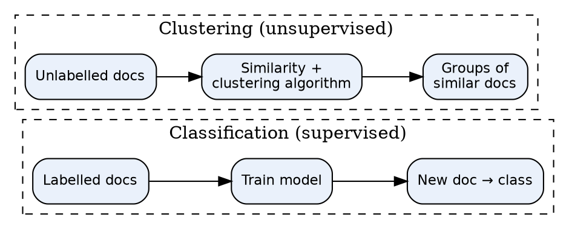
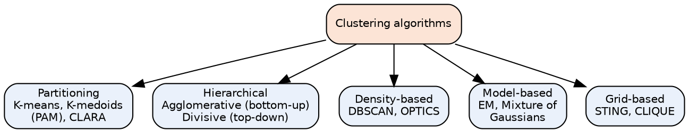
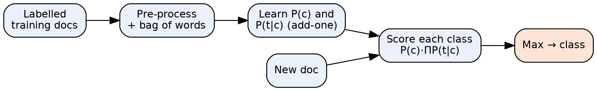
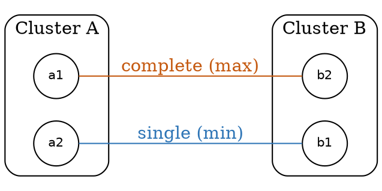
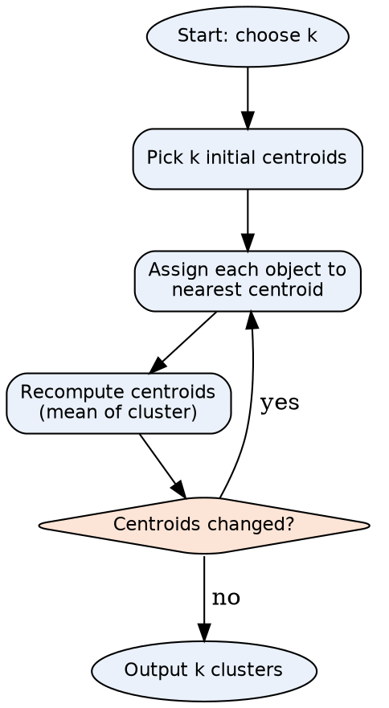

# Unit Snapshot

| No. | Question | Max Marks | Years Asked | Importance |
|---|---|---|---|---|
| 2.1 | Clustering vs classification; can clustering be used for classification? | 6 | N23, M24, N24, N25 | ★★★ |
| 2.2 | Types of clustering algorithms; explain any one | 6 | N23, M24, N24, N25 | ★★★ |
| 2.3 | Naïve Bayes algorithm & its application in text classification | 6 | N23, M24, N24, N25 | ★★★ |
| 2.4 | Agglomerative hierarchical clustering — single link with example | 8 | M24, N24, N25 | ★★★ |
| 2.5 | K-Nearest Neighbour classifier with illustration in IR | 6 | N23, N24, N25 | ★★★ |
| 2.6 | Mixture of Gaussians model | 5 | N24, N25 | ★★ |
| 2.7 | Types of agglomerative clustering | 5 | N23 | ★ |
| 2.8 | Hypothesis used in the vector space model for classification | 6 | N23 | ★ |
| 2.9 | Partitioning algorithm for clustering | 10 | M24 | ★ (high marks) |

N23 = Nov–Dec 2023, M24 = May–Jun 2024, N24 = Nov–Dec 2024, N25 = Nov–Dec 2025. Source file for all citations: *Textbooks/IR Sem7.pdf* ("PDF p." = page of the PDF, "§" = section number in the notes).

# Must-Do First (★★★)

1. **2.1** Clustering vs classification
2. **2.2** Types of clustering algorithms
3. **2.3** Naïve Bayes for text classification
4. **2.4** Single-link agglomerative clustering numerical
5. **2.5** KNN classifier in IR

**Exam strategy:** Q3 (2.1 + 2.2 + 2.3) has been asked unchanged in all four papers. Q4 in N24/N25 = 2.5 + 2.6 + 2.4. Learn 2.9 (K-means) as well — it also answers "explain any one" in 2.2.

# Full Answers

## 2.1 What is the difference between clustering and classification? Can clustering be used for classification purposes? ★★★

**Write for:** 8 marks (asked max 6) · **Asked in:** N23 Q3a, M24 Q3a, N24 Q3a, N25 Q3a (all 6 marks) · **Source:** IR Sem7.pdf, PDF p.23 (§4.2.1 Clustering vs Classification, incl. comparison table)

### Definition
- **Text classification** is a **supervised** learning task that assigns documents to **predefined classes** using **labelled training data** (e.g. spam / not spam).
- **Text clustering** is an **unsupervised** learning task that **groups similar documents** together **without predefined labels**; documents in the same cluster are more similar to each other than to documents in other clusters.

### Difference table

| Point | Classification | Clustering |
|---|---|---|
| Learning type | **Supervised** | **Unsupervised** |
| Labels / classes | **Predefined** classes, labelled data needed | **No labels**; groups discovered from data |
| Goal | **Predict the class** of a new document | **Group similar documents** together |
| Training phase | Yes — model learned from training set | No training set; works on whole collection |
| Output | Class label (e.g. Sports, Politics) | Cluster IDs (Cluster 1, 2 …), meaning given later |
| Number of groups | Fixed by the classes | Chosen by user (k) or found by algorithm |
| Algorithms | **Naïve Bayes, KNN, SVM**, decision trees, deep learning | **K-means, hierarchical (agglomerative), DBSCAN, EM/GMM** |
| Evaluation | **Accuracy, precision, recall, F1**, confusion matrix | **Purity, silhouette score**, intra/inter-cluster distance |
| Complexity | Needs costly human labelling | Cheaper — no labelling |
| IR applications | Spam filtering, sentiment analysis, topic categorisation, language identification | Search-result clustering, document organisation, topic discovery, digital libraries |



- **Classification path:** labelled data → trained model → predicts class for new document.
- **Clustering path:** unlabelled data → similarity (cosine/Euclidean) → natural groups.

### Can clustering be used for classification? — **Yes**
1. **Cluster-then-label:** cluster the documents, then a human labels each cluster (or label by the **majority class** of the few labelled documents in it); new documents get the label of the **nearest cluster centroid**.
2. **Semi-supervised learning:** when labels are few, clusters spread labels to unlabelled documents.
3. **Clusters as features:** cluster ID / distance to centroids added as extra features for a classifier.
4. **Creating training data:** clustering finds categories in an unknown collection, which then become **classes** for a classifier.
5. **Speed-up:** classify only against cluster centroids (like Rocchio) instead of every document.
- **Limitation:** clusters may not match the real classes, so accuracy is usually lower than true supervised classification.

### Example
1,000 news articles with no labels → K-means (k = 3) gives clusters whose top words are {match, goal}, {election, vote}, {stock, market} → named Sports, Politics, Business → new article placed in nearest cluster = classified.

### Conclusion
Classification = **supervised, predefined labels**; clustering = **unsupervised, discovered groups**; clustering can support classification via **cluster-then-label**.

**Memory trick:** "**Classification has a Teacher, Clustering has a Crowd**". Write at least **8 rows** in the table.

## 2.2 What are different types of clustering algorithms? Explain any one of them. ★★★

**Write for:** 8 marks (asked max 6) · **Asked in:** N23 Q3b [5], M24 Q3b [6], N24 Q3b [5], N25 Q3b [5] · **Source:** IR Sem7.pdf, PDF p.23–26 (§4.2.2 Partitioning Methods, §4.3 Clustering Algorithms: §4.3.1 K-Means, §4.3.2 Agglomerative Hierarchical, §4.3.3 EM, §4.3.4 Mixture of Gaussians). Density/grid-based types: standard textbook addition.

### Definition
A **clustering algorithm** groups data objects so that **intra-cluster similarity is high** and **inter-cluster similarity is low**.

### Types of clustering algorithms



1. **Partitioning methods:** divide N objects into **k non-overlapping partitions**; each object in exactly one cluster. E.g. **K-means**, **K-medoids (PAM)**, **CLARA**.
2. **Hierarchical methods:** build a **tree of clusters (dendrogram)**. **Agglomerative** = bottom-up merging; **Divisive** = top-down splitting.
3. **Density-based methods:** clusters = **dense regions** separated by sparse regions; find arbitrary shapes and noise. E.g. **DBSCAN**.
4. **Model-based (probabilistic) methods:** assume data comes from a **mixture of distributions**; **soft assignment**. E.g. **EM**, **Gaussian Mixture Model**.
5. **Grid-based methods:** divide space into a **grid of cells**; fast. E.g. STING.
- Also: **hard vs soft (fuzzy)** clustering — hard: one cluster per document; soft: membership probability for every cluster.

### Explained: K-Means (a centroid-based partitioning technique)
**Input:** k (number of clusters), dataset of N objects. **Output:** k clusters minimising squared error.

1. **Choose k** and randomly select **k objects as initial centroids**.
2. **Assign** each object to the **nearest centroid** (Euclidean distance / cosine similarity).
3. **Recompute** each centroid as the **mean** of its objects.
4. **Repeat** steps 2–3 until centroids **do not change** (convergence) or max iterations reached.

**Objective (squared error):** $E = \sum_{i=1}^{k}\sum_{x \in C_i} \lVert x - m_i \rVert^2$, where $C_i$ = cluster i, $m_i$ = its mean.

### Example
Points {2, 3, 4, 10, 11, 12, 20, 25, 30}, k = 2 → final clusters {2, 3, 4, 10, 11, 12} (mean 7) and {20, 25, 30} (mean 25). (Full steps in 2.9.)

### Advantages / Disadvantages of K-means
- **Advantages:** simple, fast — O(n·k·t), works well on large document sets.
- **Disadvantages:** k must be given in advance; sensitive to **initial centroids** and **outliers** (K-medoids is more robust); finds only spherical clusters.

### Conclusion
Clustering algorithms are mainly **partitioning, hierarchical, density, model and grid based**; **K-means** is the most popular partitioning method for text.

**Memory trick:** **"PHD-MG"** → **P**artitioning, **H**ierarchical, **D**ensity, **M**odel, **G**rid. ("A PhD in Machine Grouping")

## 2.3 Explain in detail about Naïve Bayes algorithm and its application in text classification. ★★★

**Write for:** 8 marks (asked max 6) · **Asked in:** N23 Q3c "What are the applications of naive Bayes classifier?", M24 Q3c, N24 Q3c, N25 Q3c (all 6 marks) · **Source:** IR Sem7.pdf, PDF p.16–17 (§4.1.2 Naïve Bayes Model — Laplace/add-one smoothing, "When to use Naïve Bayes", applications); spam filtering example PDF p.20–21 (§4.1.4)

### Definition
**Naïve Bayes (NB)** is a **probabilistic, supervised classifier** based on **Bayes' theorem** with the **"naïve" assumption** that the features (words) are **conditionally independent** given the class.

### 1. Bayes' theorem
$$P(c \mid d) = \frac{P(d \mid c)\,P(c)}{P(d)}$$
- $P(c|d)$ = **posterior** (probability of class c given document d), $P(c)$ = **prior**, $P(d|c)$ = **likelihood**, $P(d)$ = evidence (same for all classes, ignored).

### 2. Multinomial NB for text
$$c_{map} = \arg\max_{c}\; P(c) \prod_{k=1}^{n_d} P(t_k \mid c)$$
- **Prior:** $P(c) = N_c / N$ (fraction of training docs in class c).
- **Likelihood with Laplace (add-one) smoothing:** $P(t \mid c) = \dfrac{T_{ct} + 1}{\sum_{t'} T_{ct'} + |V|}$
- $T_{ct}$ = count of term t in class c documents, $|V|$ = vocabulary size. Smoothing avoids **zero probability** for unseen words. Use **log** probabilities to avoid underflow.

### 3. Algorithm steps
1. **Pre-process** text: tokenise, lowercase, remove stop words, stem.
2. **Build vocabulary** and count terms per class (bag of words / TF).
3. **Train:** compute priors $P(c)$ and smoothed likelihoods $P(t|c)$.
4. **Classify:** for a new document compute $\log P(c) + \sum \log P(t_k|c)$ for each class.
5. **Assign** the class with the **highest score**.



- **Training docs → pre-process:** convert text to word counts.
- **Learn parameters:** priors and likelihoods per class.
- **Score block:** multiplies probabilities for each class; **Max** chooses the label.

### 4. Worked example
Training: d1 "Chinese Beijing Chinese" (China), d2 "Chinese Chinese Shanghai" (China), d3 "Chinese Macao" (China), d4 "Tokyo Japan Chinese" (Japan). Test: "Chinese Chinese Chinese Tokyo Japan". |V| = 6.

- $P(China) = 3/4$, $P(Japan) = 1/4$.
- $P(Chinese|China) = (5+1)/(8+6) = 3/7$; $P(Tokyo|China) = P(Japan|China) = 1/14$.
- $P(Chinese|Japan) = (1+1)/(3+6) = 2/9$; $P(Tokyo|Japan) = P(Japan|Japan) = 2/9$.
- Score(China) = $3/4 \times (3/7)^3 \times 1/14 \times 1/14 \approx 0.0003$; Score(Japan) = $1/4 \times (2/9)^5 \approx 0.0001$ → **China**.

### 5. Applications of Naïve Bayes (text classification)
- **Spam filtering** (spam / ham) — classic use (notes §4.1.4).
- **Sentiment analysis** (positive / negative reviews).
- **News / topic categorisation**, document routing in digital libraries.
- **Language identification**, **intent detection** in chatbots.
- **Recommendation & real-time prediction** (fast), medical text classification.

### Advantages / Disadvantages
- **Advantages:** simple, **very fast**, needs little training data, works well with **high-dimensional text**, handles multiple classes.
- **Disadvantages:** **independence assumption** is unrealistic; zero-frequency problem (fixed by smoothing); probability estimates are poor (ranking OK).

### Conclusion
Naïve Bayes picks the class with **maximum posterior** $P(c)\prod P(t|c)$; despite its naïve assumption it is a **strong baseline** for spam filtering and text categorisation.

**Memory trick:** "**Prior × Product of Likelihoods → pick Max**" (PPM). Never forget **+1 / +|V| smoothing**.

## 2.4 Solve Agglomerative hierarchical clustering for single link with example. ★★★

**Write for:** 10 marks (asked max 8) · **Asked in:** M24 Q4b [8], N24 Q4c [6], N25 Q4c [6] · **Source:** IR Sem7.pdf, PDF p.25 (§4.3.2 Agglomerative Hierarchical Clustering — steps 1–7, linkage methods, dendrogram). The worked numerical below is a standard textbook-style example (no solved numerical in notes).

### Definition
**Agglomerative Hierarchical Clustering (AHC)** is a **bottom-up** method: start with **each object as its own cluster** and repeatedly **merge the two closest clusters** until one cluster remains; result is shown as a **dendrogram**. In **single link (nearest neighbour)**, the distance between two clusters is the **minimum** distance between any pair of their members:
$$d(C_i, C_j) = \min_{x \in C_i,\, y \in C_j} d(x, y)$$

### Algorithm (notes, Steps 1–7)
1. **Data representation:** convert text to vectors (TF-IDF / bag of words).
2. **Distance matrix:** compute pairwise distances (Euclidean / cosine).
3. **Initial clusters:** each point is a separate cluster.
4. **Merge closest clusters** (smallest value in matrix).
5. **Update distance matrix** using single link (take **minimum**).
6. **Repeat** steps 4–5 until one cluster (or required k clusters).
7. **Draw dendrogram** and cut at desired height to get clusters.

### Worked example
**Given:** distance matrix of 5 documents A–E.

| | A | B | C | D | E |
|---|---|---|---|---|---|
| A | 0 | 2 | 6 | 10 | 9 |
| B | 2 | 0 | 5 | 9 | 8 |
| C | 6 | 5 | 0 | 4 | 5 |
| D | 10 | 9 | 4 | 0 | 3 |
| E | 9 | 8 | 5 | 3 | 0 |

**Step 1:** Minimum distance = **2 (A, B)** → merge **{A,B}** at height 2.
Update: d(AB, C) = min(6, 5) = 5; d(AB, D) = min(10, 9) = 9; d(AB, E) = min(9, 8) = 8.

| | AB | C | D | E |
|---|---|---|---|---|
| AB | 0 | 5 | 9 | 8 |
| C | 5 | 0 | 4 | 5 |
| D | 9 | 4 | 0 | 3 |
| E | 8 | 5 | 3 | 0 |

**Step 2:** Minimum = **3 (D, E)** → merge **{D,E}** at height 3.
Update: d(AB, DE) = min(9, 8) = 8; d(C, DE) = min(4, 5) = 4.

| | AB | C | DE |
|---|---|---|---|
| AB | 0 | 5 | 8 |
| C | 5 | 0 | 4 |
| DE | 8 | 4 | 0 |

**Step 3:** Minimum = **4 (C, DE)** → merge **{C,D,E}** at height 4.
Update: d(AB, CDE) = min(5, 8) = 5.

**Step 4:** Merge **{A,B}** and **{C,D,E}** at height **5** → single cluster {A,B,C,D,E}. Stop.

### Dendrogram

```mpl single_link_dendro
fig, ax = plt.subplots(figsize=(5.2, 3.2))
x = {'A':1,'B':2,'C':3,'D':4,'E':5}
def U(x1,x2,h,y1,y2): ax.plot([x1,x1,x2,x2],[y1,h,h,y2],'k-',lw=1.6)
U(1,2,2,0,0); U(4,5,3,0,0); U(3,4.5,4,0,3); U(1.5,3.75,5,2,4)
ax.set_xticks([1,2,3,4,5]); ax.set_xticklabels(['A','B','C','D','E'])
ax.set_ylabel('Merge distance (height)'); ax.set_ylim(0,5.6)
for h,t,xx in [(2,'AB @2',1.5),(3,'DE @3',4.5),(4,'C+DE @4',3.75),(5,'All @5',2.6)]: ax.text(xx,h+0.12,t,ha='center',fontsize=9,color='#1F3A68')
ax.axhline(4.5, ls='--', color='#C55A11'); ax.text(5.3,4.55,'cut → 2 clusters',fontsize=8,color='#C55A11',ha='right')
ax.set_title('Single-link dendrogram'); ax.spines[['top','right']].set_visible(False)
```

- **Leaves (A–E):** individual documents.
- **Horizontal bars:** a merge; **height** = single-link distance at which clusters merged.
- **Dashed cut line:** cutting at height 4.5 gives **2 clusters: {A,B} and {C,D,E}**.

### Final answer
Merge order: {A,B}@2 → {D,E}@3 → {C,D,E}@4 → {A,B,C,D,E}@5. For k = 2: **{A,B}, {C,D,E}**.

### Advantages / Disadvantages of single link
- **Advantages:** finds **non-elliptical / long** clusters; simple; no k needed in advance.
- **Disadvantages:** **chaining effect** (clusters joined through a chain of close points); sensitive to noise; O(n²) memory.

### Conclusion
Single-link AHC repeatedly merges the pair of clusters with the **minimum pairwise distance**, updating the matrix with **min()** and recording merges in a **dendrogram**.

**Exam tip:** Write **"Single link → MIN, Complete link → MAX, Average link → MEAN"**. Always redraw the **reduced matrix after every merge** and finish with the **dendrogram** — that is where marks are.

## 2.5 What is K nearest neighbor classifier with an illustration in information retrieval? ★★★

**Write for:** 8 marks (asked max 6) · **Asked in:** N23 Q4a, N24 Q4a, N25 Q4a (all 6 marks) · **Source:** IR Sem7.pdf, PDF p.18–19 (§4.1.3 K-Nearest Neighbor — steps for text classification, distance metrics, choosing k)

### Definition
**K-Nearest Neighbours (KNN)** is a **non-parametric, lazy (instance-based)** supervised classifier: it **stores the training documents** and classifies a new document by the **majority class of its k nearest neighbours** in the feature (vector) space.

### Steps (notes)
1. **Data pre-processing:** tokenisation, lowercase, punctuation & stop-word removal.
2. **Feature extraction:** convert documents to vectors — **BoW or TF-IDF**.
3. **Distance metric:** choose **cosine similarity** (best for text), Euclidean or Manhattan distance.
4. **Choose k:** a hyperparameter selected by **cross-validation** (odd k avoids ties).
5. **Find k nearest neighbours** of the test document among training documents.
6. **Majority voting** (or **similarity-weighted voting**) → predicted class.

**Cosine similarity:** $\cos(\vec q, \vec d) = \dfrac{\vec q \cdot \vec d}{|\vec q|\,|\vec d|}$

**Weighted vote (score for class c):** $score(c, d) = \sum_{d' \in S_k(d)} I_c(d')\,\cos(\vec d', \vec d)$, where $S_k(d)$ = k nearest neighbours, $I_c(d')$ = 1 if $d'$ is in class c.

### Illustration in IR

```mpl knn_plot
fig, ax = plt.subplots(figsize=(5.2, 3.4))
import math
S=[(1,4),(1.5,3.2),(2.2,4.3),(2.6,3.6)]; P=[(4.6,1.2),(5.2,2.0),(4.2,0.6),(3.5,2.0)]
ax.scatter(*zip(*S), marker='s', s=70, c='#2E75B6', label='Sports docs')
ax.scatter(*zip(*P), marker='^', s=80, c='#C55A11', label='Politics docs')
q=(2.9,2.9); ax.scatter([q[0]],[q[1]], marker='*', s=260, c='green', label='New doc (query)')
ax.add_patch(plt.Circle(q, 1.5, fill=False, ls='--', color='green')); ax.set_aspect('equal')
ax.text(q[0]+0.15,q[1]+0.15,'?',fontsize=14,color='green')
ax.set_xlabel('weight of term "match"'); ax.set_ylabel('weight of term "goal"')
ax.set_title('KNN with k = 3 (circle = 3 nearest)'); ax.legend(fontsize=8, loc='lower left'); ax.set_xlim(0,6.2); ax.set_ylim(0,5.2)
```

- **Squares / triangles:** training documents of two classes in TF-IDF space.
- **Star:** new document to classify.
- **Dashed circle:** contains its **k = 3 nearest neighbours** (2 Sports, 1 Politics) → predicted **Sports**.

### Numerical illustration
Cosine similarity of new document d with training documents: D1 (Sports) 0.92, D2 (Sports) 0.85, D3 (Politics) 0.80, D4 (Politics) 0.40, D5 (Sports) 0.35. With **k = 3** → D1, D2, D3 → votes Sports 2, Politics 1 → **Sports**. (Weighted: Sports 1.77 vs Politics 0.80.)

### Uses in IR
Document categorisation, **spam filtering**, recommendation ("users/items like this"), **query classification**, duplicate detection, image retrieval by similarity.

### Advantages / Disadvantages
- **Advantages:** simple, **no training phase**, naturally multi-class, works well with enough data.
- **Disadvantages:** **slow at query time** (compare with all documents), needs memory, sensitive to **k**, noise and **curse of dimensionality**; needs good similarity measure.

### Conclusion
KNN classifies a document by **voting among its k most similar documents** (usually cosine on TF-IDF), making it a simple but effective IR classifier.

**Memory trick:** "**Tell me who your neighbours are, I'll tell you who you are.**" Write: **Lazy + Non-parametric + Majority vote**.

## 2.6 Explain Mixture of Gaussians Model. ★★

**Write for:** 7 marks (asked max 5) · **Asked in:** N24 Q4b [5], N25 Q4b [5] · **Source:** IR Sem7.pdf, PDF p.25–26 (§4.3.3 Expectation Maximization, §4.3.4 Mixture of Gaussians Model — steps 1–6)

### Definition
A **Mixture of Gaussians (MoG) / Gaussian Mixture Model (GMM)** is a **probabilistic (model-based) clustering** method which assumes the data is generated from a **mixture of k Gaussian distributions**. It gives **soft assignment** — each point has a **probability of belonging to every cluster**.

### Model formula
$$p(x) = \sum_{k=1}^{K} \pi_k\, \mathcal{N}(x \mid \mu_k, \Sigma_k), \qquad \sum_k \pi_k = 1$$
- $\pi_k$ = **mixing coefficient** (prior of component k), $\mu_k$ = **mean**, $\Sigma_k$ = **covariance matrix**, $\mathcal N$ = Gaussian density.

### Steps (EM algorithm, as in notes)
1. **Data representation:** text → numeric vectors (TF-IDF / BoW, often reduced with SVD).
2. **Initialise** k components: means, covariances, mixing coefficients.
3. **E-step (Expectation):** compute **responsibility** of each component for each point using Bayes' theorem:
   $\gamma_{nk} = \dfrac{\pi_k\,\mathcal N(x_n|\mu_k,\Sigma_k)}{\sum_j \pi_j\,\mathcal N(x_n|\mu_j,\Sigma_j)}$
4. **M-step (Maximisation):** update parameters using responsibilities as weights: $N_k = \sum_n \gamma_{nk}$, $\mu_k = \frac{1}{N_k}\sum_n \gamma_{nk}x_n$, $\pi_k = N_k/N$ (and $\Sigma_k$ similarly).
5. **Iterate** E and M steps.
6. **Convergence:** stop when log-likelihood / parameters change less than a threshold.

```mpl gmm_plot
import math
fig, ax = plt.subplots(figsize=(5.2, 2.8))
xs=[i/20 for i in range(0,201)]
g=lambda x,m,s: math.exp(-(x-m)**2/(2*s*s))/(s*math.sqrt(2*math.pi))
c1=[0.6*g(x,3,1.0) for x in xs]; c2=[0.4*g(x,7,1.2) for x in xs]
ax.plot(xs,c1,'--',color='#2E75B6',label='Component 1 (π=0.6, μ=3)')
ax.plot(xs,c2,'--',color='#C55A11',label='Component 2 (π=0.4, μ=7)')
ax.plot(xs,[a+b for a,b in zip(c1,c2)],'k-',lw=2,label='Mixture p(x)')
ax.axvline(5.2,color='green',ls=':'); ax.text(5.3,0.2,'x=5.2: γ≈0.5/0.5\n(soft membership)',fontsize=8,color='green')
ax.set_xlabel('x'); ax.set_ylabel('density'); ax.legend(fontsize=8); ax.spines[['top','right']].set_visible(False)
```

- **Dashed curves:** individual Gaussian components (clusters) weighted by $\pi_k$.
- **Solid curve:** overall mixture density p(x).
- **Green line:** a point between the clusters belongs partly to both (**soft clustering**).

### GMM vs K-means
| GMM | K-means |
|---|---|
| Soft (probabilistic) assignment | Hard assignment |
| Elliptical clusters (covariance) | Spherical clusters |
| Learned by EM | Mean update |

### Applications
Topic/document clustering with overlapping topics, speaker identification in audio retrieval, image segmentation, anomaly detection.

### Conclusion
GMM models data as a **weighted sum of Gaussians** and learns it with **EM**, giving **soft, probabilistic clusters**.

**Memory trick:** **"π-μ-Σ"** are the three parameters; **E = Estimate responsibilities, M = Maximise (update) parameters**.

## 2.7 What are the different types of agglomerative clustering? ★

**Write for:** 7 marks (asked max 5) · **Asked in:** N23 Q4b [5] · **Source:** IR Sem7.pdf, PDF p.25 (§4.3.2 — "linkage methods like single linkage, complete linkage, or average linkage"); formulas and centroid/Ward: standard textbook.

### Definition
**Agglomerative clustering** is **bottom-up hierarchical clustering**: start with every document as a cluster and **merge the two closest clusters** repeatedly. Its **types** differ by the **linkage criterion** — how the distance between two clusters is measured.

### Types (linkage methods)
1. **Single link (nearest neighbour / MIN):** $d(A,B) = \min_{a\in A, b\in B} d(a,b)$. Finds long, chained clusters; suffers **chaining effect**.
2. **Complete link (farthest neighbour / MAX):** $d(A,B) = \max_{a,b} d(a,b)$. Gives **compact, tight** clusters; sensitive to outliers.
3. **Group-average link (UPGMA / MEAN):** $d(A,B) = \dfrac{1}{|A||B|}\sum_{a\in A}\sum_{b\in B} d(a,b)$. Balance between single and complete; often best for documents.
4. **Centroid link:** distance between **cluster centroids** $d(\mu_A, \mu_B)$. Simple; may give **inversions** in dendrogram.
5. **Ward's method:** merge the pair that gives the **minimum increase in total within-cluster variance (SSE)**. Gives equal-sized, spherical clusters (used in notes' Python code: `linkage="ward"`).



- **Cluster A, B:** two clusters being compared.
- **Blue line (a2–b1):** closest pair → **single link** distance.
- **Orange line (a1–b2):** farthest pair → **complete link** distance.
- Average link = mean of all 4 pairs; centroid link = distance between the cluster centres.

### Comparison
| Linkage | Rule | Cluster shape | Weakness |
|---|---|---|---|
| Single | MIN | Long, chained | Chaining |
| Complete | MAX | Compact | Outliers |
| Average | MEAN of all pairs | Moderate | More computation |
| Centroid | Centre distance | Spherical | Inversions |
| Ward | Min SSE increase | Equal-size | Assumes spherical |

### Example
A = {1, 2}, B = {5, 9} (1-D): single = |2 − 5| = 3; complete = |1 − 9| = 8; average = (4 + 8 + 3 + 7)/4 = 5.5; centroid = |1.5 − 7| = 5.5.

### Conclusion
Types of agglomerative clustering are defined by linkage: **single, complete, average, centroid and Ward**; choice of linkage changes the shape of clusters.

**Memory trick:** **"S-C-A-C-W"** → "**S**ome **C**lusters **A**re **C**ompletely **W**eird"; Single = MIN, Complete = MAX, Average = MEAN.

## 2.8 What is the hypothesis used in the vector space model for classification? ★

**Write for:** 8 marks (asked max 6) · **Asked in:** N23 Q4c [6] · **Source:** ⚠ Not found in your materials. Standard textbook answer (Manning, Raghavan & Schütze, *Introduction to IR*, Ch. 14). Related notes: IR Sem7.pdf, PDF p.22–23 (§4.1.6 Vector space classification using hyperplanes and kernel function).

### Definition
Vector space classification is based on the **Contiguity Hypothesis**: *"Documents in the **same class form a contiguous region** in the vector space, and regions of **different classes do not overlap**."*

### 1. Explanation
- Each document is a **vector of term weights (TF-IDF)**, normalised to unit length.
- Documents about the same topic use similar words → their vectors **lie close together** (high cosine similarity).
- Therefore, a classifier only needs to find **boundaries** between these regions; a new document is labelled by the **region** it falls in.

```mpl contiguity
fig, ax = plt.subplots(figsize=(5.2, 3.2))
A=[(1,3.6),(1.4,4.2),(1.8,3.4),(1.2,2.9),(2.1,4.0)]; B=[(4,1),(4.5,1.6),(3.8,0.6),(4.9,0.9),(4.3,2.1)]; C=[(4.2,3.9),(4.8,4.4),(5.1,3.6),(3.9,4.5)]
for pts,m,c,l in [(A,'o','#2E75B6','China'),(B,'s','#C55A11','UK'),(C,'^','#548235','Kenya')]: ax.scatter(*zip(*pts),marker=m,c=c,s=55,label=l)
ax.plot([3.0,3.0],[0,5],'k--'); ax.plot([3.0,6],[2.8,2.8],'k--')
ax.scatter([1.6],[2.4],marker='*',s=220,c='black'); ax.text(1.75,2.3,'new doc → China',fontsize=8)
ax.set_xlim(0,6); ax.set_ylim(0,5); ax.set_title('Contiguity hypothesis: classes = separate regions'); ax.legend(fontsize=8,loc='lower left')
```

- **Coloured groups:** documents of three classes occupy separate, contiguous regions.
- **Dashed lines:** **decision boundaries (hyperplanes)** learned by the classifier.
- **Star:** new document falls in the China region → classified China.

### 2. Classifiers that rely on it
1. **Rocchio (centroid) classification:** class represented by its **centroid** $\vec\mu(c) = \frac{1}{|D_c|}\sum_{d \in D_c}\vec v(d)$; new document → **nearest centroid**.
2. **K-Nearest Neighbour:** label from nearby documents in the same region.
3. **Linear classifiers / SVM:** separate regions with **hyperplanes** $\vec w \cdot \vec x + b = 0$; **kernel functions** handle non-linear boundaries (notes §4.1.6).

### 3. When the hypothesis fails
- **Multimodal classes** (one class in several separate regions, e.g. "sports" covering cricket and chess) → Rocchio fails, KNN works better.
- **Overlapping vocabulary** between classes; poor document representation (e.g. without stemming/TF-IDF).
- **Choice of representation matters:** weighting and normalisation decide whether contiguity holds.

### Example
Documents about "Beijing, Chinese, Shanghai" cluster in one region; "London, Parliament, Britain" in another; a new document "Chinese Olympics in Beijing" lies in the China region → class **China**.

### Conclusion
The **contiguity hypothesis** — same-class documents form contiguous, non-overlapping regions — justifies Rocchio, KNN and hyperplane-based (SVM) classification in the vector space.

**Memory trick:** "**Birds of a feather flock together in vector space**" — Contiguity → Centroid (Rocchio) → Neighbours (KNN) → Hyperplanes (SVM).

## 2.9 Write partitioning algorithm for clustering. ★

**Write for:** 12 marks (asked max 10) · **Asked in:** M24 Q4a [10] · **Source:** IR Sem7.pdf, PDF p.23–24 (§4.2.2 Partitioning Methods — K-Means, K-Medoids (PAM), CLARA; §4.3.1 K-Means Clustering algorithm with Input/Output and worked example)

### Definition
A **partitioning method** divides a dataset of **N objects into k partitions (k ≤ N)**, where each partition is a **cluster**, each object belongs to **exactly one** cluster, and each cluster has at least one object. The number of clusters **k is specified by the user**. Popular methods (notes): **K-Means**, **K-Medoids (PAM)**, **CLARA**.

### 1. K-Means algorithm (centroid-based technique)
**Input:** k = number of clusters; D = dataset of N objects.
**Output:** a set of k clusters that minimises the **squared-error** function.

**Method:**
1. **Arbitrarily choose k objects** from D as the **initial cluster centres (centroids)**.
2. **Repeat**
3. &nbsp;&nbsp;&nbsp;**(Re)assign** each object to the cluster whose **mean is nearest** (Euclidean distance / cosine).
4. &nbsp;&nbsp;&nbsp;**Update** the cluster means: $m_i = \frac{1}{|C_i|}\sum_{x \in C_i} x$.
5. **Until** no change in cluster assignments (or max iterations).

**Squared-error criterion:** $E = \sum_{i=1}^{k}\sum_{p \in C_i} \lVert p - m_i \rVert^2$ — p = object, $m_i$ = mean of cluster $C_i$. K-means aims for **high intra-cluster** and **low inter-cluster similarity**.



- **Choose k / initial centroids:** user input; random selection.
- **Assign:** distance calculation for every object.
- **Recompute:** move centroid to mean of assigned objects.
- **Decision:** loop until stable → output clusters.

### 2. Worked example (k = 2)
**Given:** {2, 3, 4, 10, 11, 12, 20, 25, 30}; initial means $m_1 = 2$, $m_2 = 4$.

| Iteration | Means used | Cluster 1 | Cluster 2 | New means |
|---|---|---|---|---|
| 1 | 2, 4 | {2, 3} | {4, 10, 11, 12, 20, 25, 30} | 2.5, 16 |
| 2 | 2.5, 16 | {2, 3, 4} | {10, 11, 12, 20, 25, 30} | 3, 18 |
| 3 | 3, 18 | {2, 3, 4, 10} | {11, 12, 20, 25, 30} | 4.75, 19.6 |
| 4 | 4.75, 19.6 | {2, 3, 4, 10, 11, 12} | {20, 25, 30} | 7, 25 |
| 5 | 7, 25 | {2, 3, 4, 10, 11, 12} | {20, 25, 30} | 7, 25 (no change) |

**Final answer:** $C_1$ = {2, 3, 4, 10, 11, 12} (mean 7), $C_2$ = {20, 25, 30} (mean 25). (Tie at 3 with means 2 and 4 is assigned to the first cluster.)

### 3. K-Medoids (PAM — Partitioning Around Medoids)
1. Select **k representative objects (medoids)** — actual data points.
2. Assign each remaining object to the **nearest medoid**.
3. For each medoid m and non-medoid o: **swap** them and compute total cost **S**.
4. If S < 0 (cost decreases), keep the swap.
5. Repeat until no improvement.
- **More robust to outliers** than K-means (medoid is a real point, not a mean).

### 4. CLARA (Clustering LARge Applications)
- Applies **PAM on random samples** of the data and picks the best set of medoids → scales to **large datasets**.

### 5. Text clustering with K-means (notes code idea)
TF-IDF vectorise documents → (optional) TruncatedSVD to reduce dimensions → `KMeans(n_clusters=k).fit_predict(X)` → print documents per cluster.

### Advantages / Disadvantages
| Advantages | Disadvantages |
|---|---|
| Simple, easy to implement | k must be known in advance |
| Efficient: O(n·k·t) | Sensitive to initial centroids |
| Works well for large document sets | Sensitive to outliers (use K-medoids) |
| Clusters easy to interpret (centroid terms) | Only spherical, similar-size clusters |

### Conclusion
Partitioning algorithms (K-means, K-medoids, CLARA) split data into **k exclusive clusters** by iteratively **assigning objects to the nearest centre and updating centres** until the squared error stops decreasing.

**Memory trick:** K-means loop = "**A-U-R**": **A**ssign → **U**pdate → **R**epeat. "Means for speed, Medoids for outliers, CLARA for large data."

# Last-Minute Revision Sheet — Unit 2

| Topic | Key point to write |
|---|---|
| Classification vs clustering | Supervised + predefined labels vs unsupervised + discovered groups |
| Clustering for classification | Cluster-then-label; semi-supervised; clusters as features |
| Clustering types | PHD-MG: Partitioning, Hierarchical, Density, Model, Grid |
| K-means | Choose k → assign to nearest mean → update means → repeat; $E=\sum\sum\lVert p-m_i\rVert^2$ |
| K-medoids / CLARA | Real points as centres (robust to outliers) / PAM on samples (large data) |
| Naïve Bayes | $c=\arg\max P(c)\prod P(t_k|c)$; add-one: $(T_{ct}+1)/(\sum T_{ct'}+|V|)$ |
| NB applications | Spam filtering, sentiment, topic categorisation, language ID, intent detection |
| KNN | Lazy, non-parametric; cosine on TF-IDF; majority (or weighted) vote of k neighbours |
| Single link | $d=\min$; update matrix with min; dendrogram; chaining effect |
| Linkage types | Single (MIN), Complete (MAX), Average (MEAN), Centroid, Ward (min SSE) |
| GMM | $p(x)=\sum\pi_k\mathcal N(x|\mu_k,\Sigma_k)$; EM: E = responsibilities, M = update; soft clusters |
| Contiguity hypothesis | Same-class docs form contiguous, non-overlapping regions → Rocchio, KNN, SVM |

**Mnemonics:** Teacher vs Crowd (2.1) · PHD-MG (2.2) · PPM + smoothing (2.3) · MIN/MAX/MEAN (2.4, 2.7) · "Tell me your neighbours" (2.5) · π-μ-Σ (2.6) · Birds of a feather (2.8) · A-U-R (2.9).

# Assumptions & Gaps

- **Unit mapping:** Q3/Q4 of every paper mapped to Unit 2 = syllabus Unit IV (Text Classification and Text Clustering).
- **⚠ Not found in your materials:** 2.8 contiguity hypothesis (the notes cover hyperplane/kernel classification but never state the hypothesis); worked numerical for 2.4 (notes give the steps but no solved example — example data was chosen by me); formulas for centroid/Ward linkage in 2.7; density/grid-based types in 2.2.
- **2.3** merges N23's "applications of naïve Bayes classifier" with the later "algorithm and its application" wording — the answer covers both.
- **2.9** asked once for 10 marks; the notes' K-means worked example was not fully legible in the OCR, so a standard 1-D example is used.
- Citations give PDF page numbers of *IR Sem7.pdf* (two printed pages per PDF page) and section numbers printed in the notes.
