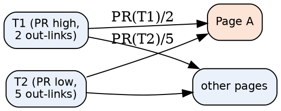
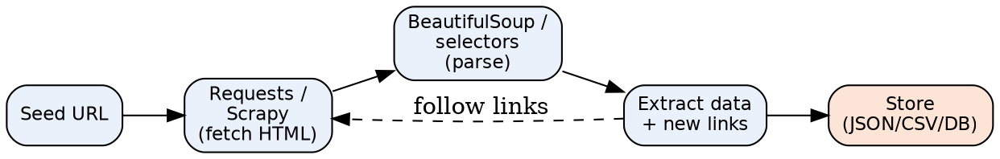
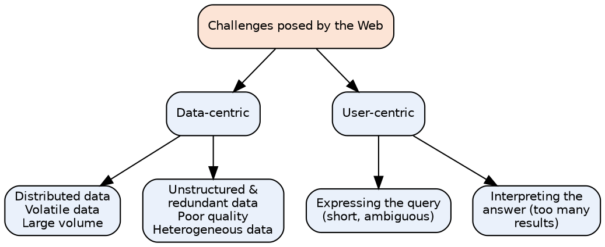
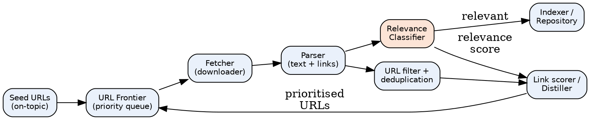
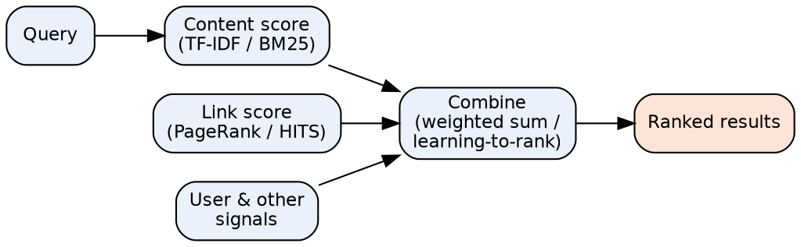
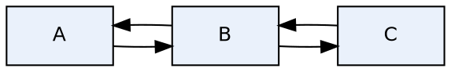
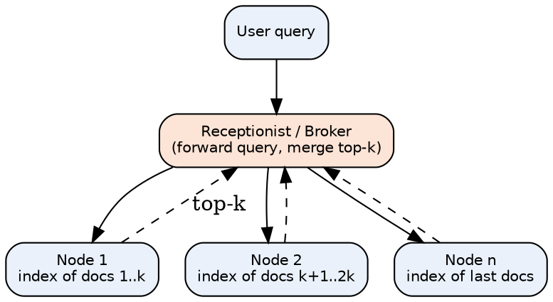
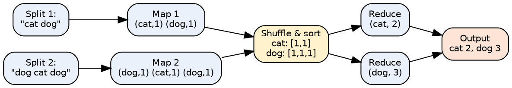

# Unit Snapshot

| No. | Question | Max Marks | Years Asked | Importance |
|---|---|---|---|---|
| 3.1 | Factors influencing PageRank score; challenges in web search engines | 8 | N23, M24, N24 (×2), N25 | ★★★ |
| 3.2 | Python libraries used for web crawling | 6 | N23, M24, N24 (×2), N25 | ★★★ |
| 3.3 | Main challenges posed by the Web | 6 | N23, M24, N24, N25 | ★★★ |
| 3.4 | Components of focused web crawlers | 6 | N23, M24, N24, N25 | ★★★ |
| 3.5 | Search engine ranking function / simple ranking functions | 6 | N23, N25 | ★★ |
| 3.6 | What is page ranking? PageRank numerical (d = 0.7) | 10 | M24 | ★ (high marks) |
| 3.7 | Parallelism in query processing | 6 | N23 | ★ |
| 3.8 | MapReduce with example | 6 | N25 | ★ |

N23 = Nov–Dec 2023, M24 = May–Jun 2024, N24 = Nov–Dec 2024, N25 = Nov–Dec 2025. Source file for all citations: *Textbooks/IR Sem7.pdf* ("PDF p." = page of the PDF, "§" = section number in the notes).

# Must-Do First (★★★)

1. **3.1** PageRank factors + search-engine challenges
2. **3.2** Python crawling libraries (Scrapy, BeautifulSoup)
3. **3.3** Challenges posed by the Web
4. **3.4** Focused crawler components

**Exam strategy:** Q6 (3.3 + 3.4 + "Python library") has been asked in all four papers — the safest choice. Also practise the PageRank numerical (3.6): it carries 10 marks and the same formula answers 3.1.

# Full Answers

## 3.1 Discuss the factors that influence a webpage's PageRank score. Discuss the challenges involved in web search engines. ★★★

**Write for:** 10 marks (asked max 8) · **Asked in:** N23 Q5a [6], M24 Q5a [8], N24 Q5a [6] and Q5b [5], N25 Q5b [5] · **Source:** IR Sem7.pdf, PDF p.40–42 (§5.2.5 Link Based Ranking, §5.3 Page Ranking Algorithm — key steps, damping factor, convergence); challenges: PDF p.32 & p.35 (coverage & freshness; index size problem, §5.2). Full challenge list partly standard textbook.

### Definition
**PageRank** (Larry Page & Sergey Brin, Stanford, used by **Google**) is a **link-analysis algorithm** that measures the **importance of a web page** from the **number and quality of links pointing to it**. A link from page T to page A is treated as a **"vote"** for A.

### PageRank formula
$$PR(A) = (1-d) + d\left(\frac{PR(T_1)}{C(T_1)} + \cdots + \frac{PR(T_n)}{C(T_n)}\right)$$
- $T_1 \ldots T_n$ = pages linking **to** A; $C(T_i)$ = number of **outgoing links** of $T_i$; $d$ = **damping factor** (≈ 0.85).

### Part A: Factors that influence PageRank
1. **Number of inbound links (backlinks):** more pages linking to A → higher PR.
2. **Quality (PageRank) of linking pages:** a link from a high-PR page (e.g. a news site) is worth more than many links from unknown pages.
3. **Number of outbound links on the linking page:** a page's PR is **divided equally** among its out-links → a link from a page with few out-links passes more PR.
4. **Damping factor (d):** probability the **random surfer** follows a link (1 − d = jumps to a random page); controls convergence and distribution.
5. **Link structure / internal linking:** good internal links spread PR inside a site; **dangling pages** (no out-links) and **rank sinks/loops** affect scores.
6. **Relevance & authority of the linking site:** topically related, trusted sites (HITS: hubs & authorities) give stronger votes.
7. **Link spam & manipulation:** **link farms**, paid links are detected and **penalised**; `nofollow` links pass no PR.
8. **Age and stability of links / freshness** of the page.



- **T1, T2:** pages linking to A (in-links).
- **Edge labels:** the share of PR each page passes = its PR ÷ its out-links.
- **Page A:** its PR = (1 − d) + d × sum of received shares.

### Part B: Challenges in web search engines
1. **Scale:** billions of pages, huge index; needs distributed/parallel architectures (notes: "how Google can search 30 trillion pages").
2. **Coverage & freshness:** crawling enough pages and keeping the index **up to date** (notes p.32).
3. **Dynamic / hidden (deep) web content:** JavaScript pages, forms, databases are hard to crawl.
4. **Spam & manipulation:** keyword stuffing, link farms, cloaking.
5. **Duplicate & near-duplicate pages:** mirrors, copied content waste resources.
6. **Query ambiguity & short queries:** "jaguar" (car/animal); understanding user intent.
7. **Ranking quality & relevance** for diverse users; personalisation vs **privacy**.
8. **Multilingual & multimedia content**, heterogeneous formats (HTML, PDF, images).
9. **Fast response (latency)** and **high throughput** under heavy query load; fault tolerance.

### Conclusion
PageRank depends mainly on the **quantity and quality of in-links, out-link count of linking pages and the damping factor**; search engines must also fight **scale, freshness, spam, duplicates and ambiguity**.

**Memory trick:** PageRank factors = **"IQ-ODS"** → **I**nbound links, **Q**uality of linkers, **O**utbound count, **D**amping factor, **S**pam/structure. Challenges = **"SCALE-D"**: **S**ize, **C**overage/freshness, **A**mbiguity, **L**ink spam, **E**fficiency (latency), **D**uplicates.

## 3.2 Define Python library used for web crawling. ★★★

**Write for:** 8 marks (asked max 6) · **Asked in:** N23 Q6a, M24 Q6a, N24 Q5c and Q6a, N25 Q5c (all 6 marks) · **Source:** IR Sem7.pdf, PDF p.43–46 (§5.4.2 Web Crawler Libraries, Python Scrapy — why use, features, advantages; §5.4.3 Beautiful Soup)

### Definition
A **web crawler (spider/bot)** is a program that **automatically browses the web**, downloads pages and extracts data/links. **Python libraries** for crawling provide ready-made tools for **sending HTTP requests, parsing HTML, following links and storing data**. The main ones (notes): **Scrapy** and **BeautifulSoup**; others: **Requests, Selenium, lxml, Puppeteer (Pyppeteer)**.

### 1. Scrapy (crawling framework)
- **Fast, open-source** web crawling **framework** in Python (first released **2008**, BSD licence, v1.0 in 2015).
- Extracts data using **selectors (XPath / CSS)**.
- Handles requests **asynchronously** (Twisted) → very fast; **auto-throttling** adjusts crawl speed.
- **Feed exports** in **JSON, CSV, XML**; built-in support for pipelines, middleware, robots.txt.
- Best for **large, scalable crawling projects**.

### 2. BeautifulSoup (HTML/XML parser)
- Library to **parse HTML/XML** and navigate the **parse tree** (find tags, attributes, text).
- Usually used with **Requests** (to download pages).
- Very easy for **small scraping tasks**; handles broken HTML; not a full crawler (no scheduling/async).

### 3. Other libraries
- **Requests:** simple HTTP GET/POST to fetch pages.
- **Selenium / Puppeteer:** control a real browser → crawl **JavaScript-rendered (dynamic)** pages.
- **lxml:** very fast XML/HTML parsing with XPath.

### Crawling workflow with Python



- **Seed URL:** starting page. **Fetch:** HTTP request returns HTML. **Parse:** build tree and select elements. **Extract:** required data and new links (loop back). **Store:** export results.

### Example (BeautifulSoup)
```
import requests
from bs4 import BeautifulSoup
html = requests.get("https://example.com").text
soup = BeautifulSoup(html, "html.parser")
for a in soup.find_all("a"):
    print(a.get("href"))        # all links on the page
```

**Scrapy spider (outline):** `class QuoteSpider(scrapy.Spider): name="quotes"; start_urls=[...]; def parse(self, response): yield {"text": response.css("span.text::text").get()}` → run `scrapy crawl quotes -o out.json`.

### Scrapy vs BeautifulSoup
| Scrapy | BeautifulSoup |
|---|---|
| Complete crawling **framework** | Only a **parser** library |
| Asynchronous, very fast | Synchronous, slower |
| Built-in link following, pipelines, export | Needs Requests + own code |
| Best for large projects | Best for small/one-page tasks |

### Conclusion
**Scrapy** (framework) and **BeautifulSoup** (parser), with **Requests/Selenium**, are the main Python tools for building web crawlers and scrapers.

**Memory trick:** "**Scrapy Scales, Soup Simplifies, Selenium Sees JavaScript**".

## 3.3 What are the main challenges posed by the Web? ★★★

**Write for:** 8 marks (asked max 6) · **Asked in:** N23 Q6b [5], M24 Q6b [6], N24 Q6b [5], N25 Q6b [5] · **Source:** Partly in IR Sem7.pdf, PDF p.32 (coverage & freshness challenge for crawlers) and PDF p.35 (index size problem for the whole Web). Structured classification: ⚠ Not found in your materials — standard textbook answer (Baeza-Yates & Ribeiro-Neto, *Modern IR*, Ch. 11).

### Definition
The **Web** is a huge, **distributed, dynamic and heterogeneous** collection of documents. It poses challenges for IR that do not exist in a small, controlled document collection. They are grouped into **data-centric** and **user-centric** challenges.



### A. Data-centric challenges
1. **Distributed data:** pages spread over millions of servers with **no central control** or common structure.
2. **Volatile (dynamic) data:** pages are **added, changed and deleted** constantly; broken links (404) — keeping the index **fresh** is hard.
3. **Large volume:** billions of pages → huge storage, crawling and indexing cost (notes: index size problem).
4. **Unstructured and redundant data:** mostly free text/HTML; around 30% pages are **duplicates/near-duplicates** (mirrors).
5. **Quality of data:** no editorial control → **false, outdated, poorly written** content; **spam**.
6. **Heterogeneous data:** many **formats** (HTML, PDF, images, video), **languages** and character sets.
7. **Hidden / deep web:** content behind forms, logins and JavaScript cannot be crawled easily.

### B. User-centric (interaction) challenges
8. **How to specify a query:** users type **short (2–3 word), ambiguous** queries and don't know the vocabulary.
9. **How to interpret the answer:** millions of results; users look only at the **top 10** → ranking must be excellent.
10. **Diverse users and intents:** informational, navigational, transactional queries; personalisation vs **privacy**.

### Additional system challenges
- **Adversarial IR:** SEO spam, link farms, cloaking.
- **Scalability & latency:** answering thousands of queries per second in milliseconds.
- **Politeness & legal issues** while crawling (robots.txt, copyright).

### Example
A query "apple" must handle fruit vs company (ambiguity), 100+ million matching pages (volume), pages updated every minute (volatility) and spam pages using "apple" keywords (quality).

### Conclusion
The Web is **big, dynamic, distributed, heterogeneous, low-quality in parts and used by non-expert users** — search engines handle these with distributed crawling/indexing, link analysis and good ranking.

**Memory trick:** **"DVLUQH + QI"** → **D**istributed, **V**olatile, **L**arge, **U**nstructured/redundant, **Q**uality, **H**eterogeneous + **Q**uery formulation, **I**nterpretation of results.

## 3.4 Explain the components of focused web crawlers. ★★★

**Write for:** 8 marks (asked max 6) · **Asked in:** N23 Q6c, M24 Q6c, N24 Q6c, N25 Q6c (all 6 marks) · **Source:** IR Sem7.pdf, PDF p.32 ("Topical or Focused Crawlers" under crawler types) and PDF p.43 (§5.4.1 Web Crawler Structure — seed URLs, URL frontier, fetcher, URL filter, parser, URL deduplication, indexer, scheduler, politeness policy, crawl control). Classifier/distiller components: standard textbook (Chakrabarti et al.).

### Definition
A **focused (topical) crawler** is a web crawler that **downloads only pages relevant to a particular topic** (e.g. "cricket" or "medical research") instead of crawling the whole web. It **predicts the relevance** of a page/link **before** downloading it, saving bandwidth and storage.

### Architecture



### Components
1. **Seed URLs:** starting list of **highly relevant pages** on the topic (from experts or a search engine).
2. **URL Frontier (priority queue):** holds URLs to be visited; unlike a normal crawler, URLs are **ordered by predicted relevance score** (best-first crawling).
3. **Fetcher / Downloader:** sends HTTP requests and downloads the HTML of the highest-priority URL; obeys **robots.txt**.
4. **Parser:** extracts **text, links, anchor text and metadata** from the downloaded page.
5. **Relevance (topic) Classifier:** decides **how relevant the page is to the topic** (e.g. Naïve Bayes, SVM, cosine similarity with a topic profile). Relevant pages are stored; irrelevant pages are discarded or given low priority.
6. **Link Scorer / Distiller:** assigns a **priority to each out-link** using parent-page relevance, **anchor text**, URL words and **hub scores** (pages that link to many relevant pages).
7. **URL Filter & De-duplication:** removes already-seen, disallowed, off-domain or duplicate URLs.
8. **Scheduler & Politeness policy:** controls order/rate of requests so servers are not overloaded (crawl control & throttling).
9. **Indexer / Repository:** stores relevant pages and builds the index for search.

### Working (steps)
1. Put seed URLs in the frontier → 2. Fetch top URL → 3. Parse → 4. Classify relevance → 5. Store if relevant → 6. Score out-links → 7. Insert into frontier by priority → repeat until budget ends.

### Advantages / Applications
- Saves **bandwidth, storage and time**; fresher topical index.
- Used for **vertical search engines** (job, medical, academic search), digital libraries, competitive intelligence, news monitoring.

### Conclusion
A focused crawler = **normal crawler + relevance classifier + link-priority scorer**, so it follows only promising links and builds a high-quality, topic-specific collection.

**Memory trick:** "**S-F-F-P-C-L**" → **S**eeds → **F**rontier → **F**etcher → **P**arser → **C**lassifier → **L**ink scorer (loop). Classifier + Distiller = what makes it "focused".

## 3.5 Explain search engine ranking function / simple ranking functions in detail. ★★

**Write for:** 8 marks (asked max 6) · **Asked in:** N23 Q5b "Explain search engine ranking function?" [5], N25 Q6a "Explain Simple Ranking Functions in detail" [6] · **Source:** IR Sem7.pdf, PDF p.31–32 (§5.2.4 Search Engine Ranking — ranking algorithms, factors), PDF p.42 (§5.3.1 Simple Ranking Functions and Evaluations — TF-IDF, BM25, evaluation: precision, recall, F1, MAP)

### Definition
A **ranking function** is a formula that computes a **relevance score** for each document with respect to a query, so that results can be **sorted (ranked)** in decreasing order of relevance. Search engines combine **content-based** scores (TF-IDF, BM25) with **link-based** (PageRank) and **user/behaviour** signals.

### 1. Simple ranking functions
**(a) Boolean / term-match count** — score = number of query terms present (no weighting).

**(b) TF-IDF**
$$score(q,d) = \sum_{t \in q} tf_{t,d} \times \log\frac{N}{df_t}$$
- $tf_{t,d}$ = frequency of t in d; $N$ = total docs; $df_t$ = docs containing t.

**(c) Vector space cosine similarity**
$$\cos(\vec q,\vec d) = \frac{\sum_t w_{t,q}\,w_{t,d}}{\sqrt{\sum_t w_{t,q}^2}\sqrt{\sum_t w_{t,d}^2}}$$

**(d) Okapi BM25** (probabilistic; best simple function)
$$BM25(q,d) = \sum_{t \in q} \log\frac{N - df_t + 0.5}{df_t + 0.5}\cdot\frac{tf_{t,d}\,(k_1+1)}{tf_{t,d} + k_1\left(1 - b + b\,\frac{L_d}{L_{avg}}\right)}$$
- $k_1$ (≈1.2) controls **TF saturation**; $b$ (≈0.75) controls **length normalisation**; $L_d$ = doc length, $L_{avg}$ = average length.

**(e) Query-likelihood (language model)** — $score = \prod_{t\in q} p(t|M_d)$ with smoothing.

### 2. Search engine (combined) ranking function
$$Score(d,q) = \alpha \cdot Content(d,q) + \beta \cdot PageRank(d) + \gamma \cdot Other(d)$$
- **Content:** BM25/TF-IDF, term proximity, matches in **title/anchor text** (fields, BM25F).
- **Link-based:** **PageRank, HITS** authority.
- **Other signals:** freshness, click-through rate, location, personalisation, page speed. Modern engines learn the weights with **learning-to-rank**.



- **Content score:** how well text matches the query. **Link score:** page importance from links. **User signals:** clicks, freshness, location. **Combine:** final score used to sort results.

### 3. Evaluation of ranking (notes)
- **Precision** = relevant retrieved / retrieved; **Recall** = relevant retrieved / total relevant.
- **F1** = $\dfrac{2PR}{P+R}$; **MAP** = mean of average precision over queries; **NDCG** for graded relevance; **P@10**.

### Example
Query "solar energy": doc1 has "solar" 3 times (df = 10) and "energy" 2 times (df = 100) in N = 1000 → TF-IDF = 3×log(100) + 2×log(10) = 3×2 + 2×1 = **8**; doc2 has "energy" 5 times only → 5×1 = **5** → doc1 ranked first.

### Conclusion
Simple ranking functions (**TF-IDF, cosine, BM25, LM**) score documents by query–content match; web search engines combine them with **PageRank and user signals** and evaluate them with **precision, recall, MAP, NDCG**.

**Memory trick:** "**T-C-B-L**" → **T**F-IDF, **C**osine, **B**M25, **L**anguage model; final rank = **Content + Links + Users**.

## 3.6 What is page ranking? Calculate page rank of following web pages. Assume damping factor 0.7. ★

**Write for:** 12 marks (asked max 10) · **Asked in:** M24 Q5b [10] · **Source:** IR Sem7.pdf, PDF p.41–42 (§5.3 Page Ranking Algorithm — graph representation, initial scores, iterative calculation, damping factor, convergence; random-walk matrix R = βP + (1 − β)ve)

### Definition
**Page ranking** is the process of assigning an **importance score (PageRank)** to every web page using the **link structure of the web**. A page is important if **many important pages link to it**. It models a **random surfer** who follows links with probability d and jumps to a random page with probability (1 − d).

### Algorithm steps (notes)
1. **Graph representation:** pages = nodes, hyperlinks = directed edges.
2. **Initial score:** every page gets an **equal PageRank** (1, or 1/N).
3. **Iterative calculation:** recompute each page's PR from the PR of pages linking to it.
4. **Damping factor d:** handles **dead ends** and **loops**; usually 0.85.
5. **Convergence:** stop when scores change very little between iterations.

**Formula:** $PR(A) = (1-d) + d\sum_{T \to A}\dfrac{PR(T)}{C(T)}$ — $C(T)$ = number of out-links of T.

### Given graph (from paper)



- Links: **A → B, B → A, B → C, C → B**. Out-degrees: **C(A) = 1, C(B) = 2, C(C) = 1**. d = 0.7, so (1 − d) = 0.3.

### Equations
- $PR(A) = 0.3 + 0.7 \times \dfrac{PR(B)}{2}$
- $PR(B) = 0.3 + 0.7 \times \left(\dfrac{PR(A)}{1} + \dfrac{PR(C)}{1}\right)$
- $PR(C) = 0.3 + 0.7 \times \dfrac{PR(B)}{2}$

### Iterative solution (initial PR = 1 for all; latest values used immediately)

| Iteration | PR(A) | PR(B) | PR(C) |
|---|---|---|---|
| 0 | 1.0000 | 1.0000 | 1.0000 |
| 1 | 0.3 + 0.35(1) = 0.6500 | 0.3 + 0.7(0.65 + 1) = 1.4550 | 0.3 + 0.35(1.455) = 0.8093 |
| 2 | 0.3 + 0.35(1.455) = 0.8093 | 0.3 + 0.7(0.8093 + 0.8093) = 1.4330 | 0.8015 |
| 3 | 0.8015 | 1.4221 | 0.7978 |
| 4 | 0.7978 | 1.4169 | 0.7959 |
| 5 | 0.7959 | 1.4143 | 0.7950 |
| … converges to | **0.7941** | **1.4118** | **0.7941** |

### Exact (steady-state) solution
By symmetry PR(A) = PR(C) = x, PR(B) = y:
- $y = 0.3 + 1.4x$ and $x = 0.3 + 0.35y$
- $x = 0.3 + 0.35(0.3 + 1.4x) = 0.405 + 0.49x \Rightarrow 0.51x = 0.405 \Rightarrow x = 0.7941$
- $y = 0.3 + 1.4(0.7941) = 1.4118$

### Final answer
**PR(A) = 0.794, PR(B) = 1.412, PR(C) = 0.794** (sum = 3 = number of pages ✓).
**B has the highest PageRank** because it receives links from both A and C; A and C are equal (symmetric).
*(Normalised form $PR = \frac{1-d}{N} + d\sum\ldots$ gives A = C = 0.265, B = 0.471, sum = 1 — same ranking.)*

### Conclusion
PageRank is computed iteratively until convergence; here **B > A = C**, showing that pages with more incoming links from other pages gain higher importance.

**Exam tip:** Always (1) write the formula, (2) list out-degrees, (3) write one equation per page, (4) show 2–3 iterations in a table, (5) give the converged values and **check the sum = N**.

## 3.7 What is parallelism in query processing? ★

**Write for:** 8 marks (asked max 6) · **Asked in:** N23 Q5c [6] · **Source:** IR Sem7.pdf, PDF p.28–30 (§5.1 Parallel Information Retrieval, §5.1.1 Parallel Query Processing — document partitioning, term partitioning, replication; Fig. 5.2 document-partitioned search engine) and PDF p.39 (Google-style cluster: load balancer, shards, result merging)

### Definition
**Parallel query processing** uses **many machines (nodes) working simultaneously** to answer search queries, either to **reduce response time** (latency) or to **increase throughput** (queries per second / service rate). With n machines, a search engine can ideally reach an **n-fold increase in service rate**.

### Two forms of parallelism
1. **Intra-query parallelism:** **one query** is split and processed **on many machines at once** → lower response time. Achieved by **index partitioning**.
2. **Inter-query parallelism:** **different queries** are processed **on different machines** at the same time → higher throughput. Achieved by **replication**.

### 1. Document partitioning
- Collection divided into **n subsets (shards)**; each node builds a **complete index for its own documents**.
- A **receptionist (broker)** sends the query to **all nodes**; each returns its **top-k** results; receptionist **merges** them into the final ranking.
- **Advantages:** easy to build, good **load balance**, fault-tolerant (losing a node loses only some documents). **Used by Google/most engines.**
- **Disadvantage:** every query touches every node; global statistics (IDF) must be shared.



- **User query** enters the **receptionist**, which broadcasts it to all **nodes**.
- Each **node** searches only its own documents (in parallel) and returns its local top-k (dashed arrows).
- **Receptionist** merges the lists and returns the final top results.

### 2. Term partitioning
- The **dictionary/postings are split by term**: each node holds the **complete postings lists for a subset of terms**.
- A query is sent only to nodes holding its terms; postings are combined (pipelined) to compute scores.
- **Advantages:** fewer disk seeks, only relevant nodes busy. **Disadvantages:** **poor load balance** (popular terms overload nodes), large data transfer, hard to update → rarely used.

### 3. Replication (inter-query)
- Copies of the index (or of each shard) on several machines; a **load balancer** sends each query to a free replica → throughput ↑ and **fault tolerance** ↑. Popular results are **cached**.

### Comparison
| Feature | Document partitioning | Term partitioning |
|---|---|---|
| Split by | Documents | Terms |
| Nodes per query | All | Only nodes with query terms |
| Load balance | Good | Poor |
| Scalability / updates | Easy | Difficult |
| Used in practice | Yes (web engines) | Rarely |

### Conclusion
Parallelism in query processing uses **partitioning (intra-query)** to cut response time and **replication (inter-query)** to raise throughput; **document partitioning + replication** is the standard web-search design.

**Memory trick:** "**Partition for Speed, Replicate for Load**"; **D**ocument partitioning = **D**efault choice.

## 3.8 Describe MapReduce with example. ★

**Write for:** 8 marks (asked max 6) · **Asked in:** N25 Q5a [6] · **Source:** IR Sem7.pdf, PDF p.30–31 (§5.1.2 MapReduce — framework for massively parallel computations, shards, map fragments, final output)

### Definition
**MapReduce** is a **programming framework (developed at Google)** for **massively parallel processing of very large data sets** on a **cluster of commodity machines**. The programmer writes only two functions — **Map** and **Reduce**; the framework handles **splitting, distribution, shuffling, fault tolerance and load balancing**.

### Phases
1. **Input splitting:** input data divided into **shards/splits** (e.g. 64 MB), each assigned to a map worker.
2. **Map phase:** `map(key, value) → list of (key', value')` — processes each record and emits **intermediate key–value pairs**.
3. **Shuffle & sort:** intermediate pairs are **grouped by key** and sent to reducers (all values of one key go to the same reducer).
4. **Reduce phase:** `reduce(key', list of values) → output` — **aggregates** the values of each key.
5. **Output:** results written to the distributed file system (GFS/HDFS).

### Example: word count
**Input:** Doc1 = "cat dog", Doc2 = "dog cat dog".



- **Splits:** input documents divided among map workers.
- **Map:** emits (word, 1) for every word.
- **Shuffle & sort:** groups all values of the same word together.
- **Reduce:** sums the list → word frequency. **Output:** final counts.

**Pseudo-code:**
```
map(docID, text):   for each word w in text: emit(w, 1)
reduce(w, counts):  emit(w, sum(counts))
```

### MapReduce in IR
- **Building an inverted index:** map emits (term, docID); reduce collects the **postings list** for each term.
- Computing **document frequencies, PageRank iterations**, link graphs, duplicate detection over the whole web.

### Advantages / Disadvantages
- **Advantages:** automatic **parallelism & fault tolerance** (failed tasks re-executed), **scalable** to thousands of machines, simple programming model, runs on cheap hardware.
- **Disadvantages:** high latency (batch only), not good for iterative/real-time jobs, heavy disk I/O between phases.

### Conclusion
MapReduce processes huge data by **Map (emit key–value pairs) → Shuffle (group by key) → Reduce (aggregate)**; search engines use it for **index construction** and web-scale analytics.

**Memory trick:** "**Split → Map → Shuffle → Reduce → Store**" = "**S-M-S-R-S**: Some Mangoes Should Remain Sweet".

# Last-Minute Revision Sheet — Unit 3

| Topic | Key point to write |
|---|---|
| PageRank formula | $PR(A)=(1-d)+d\sum PR(T)/C(T)$; d ≈ 0.85; random surfer |
| PageRank factors | IQ-ODS: Inbound links, Quality of linkers, Outbound count, Damping, Spam/structure |
| Numerical (M24) | A↔B↔C, d = 0.7 → A = C = 0.794, B = 1.412; sum = N |
| Search-engine challenges | SCALE-D: Size, Coverage/freshness, Ambiguity, Link spam, Efficiency, Duplicates |
| Web challenges | Data: distributed, volatile, large, unstructured/redundant, quality, heterogeneous; User: query, interpretation |
| Python libraries | Scrapy (async framework, XPath/CSS selectors, JSON/CSV export), BeautifulSoup (parser), Requests, Selenium |
| Focused crawler | Seeds → Frontier (priority) → Fetcher → Parser → Classifier → Link scorer/Distiller → Frontier |
| Crawler structure (notes) | Seed URLs, URL frontier, fetcher, URL filter, parser, dedup, indexer, scheduler, politeness |
| Ranking functions | TF-IDF, cosine, BM25 ($k_1$, b), LM; final = content + links + user signals |
| Evaluation | Precision, Recall, F1 = 2PR/(P+R), MAP, NDCG |
| Parallel query processing | Intra-query (partitioning) vs inter-query (replication); document vs term partitioning |
| MapReduce | Split → Map (k,v) → Shuffle/sort → Reduce → Output; word count; inverted index |
| HITS | Hub score (links to good authorities), Authority score (linked by good hubs) |

**Mnemonics:** IQ-ODS · SCALE-D · "Scrapy Scales, Soup Simplifies" · DVLUQH + QI · S-F-F-P-C-L · T-C-B-L · "Partition for Speed, Replicate for Load" · S-M-S-R-S.

# Assumptions & Gaps

- **Unit mapping:** Q5/Q6 of every paper mapped to Unit 3 = syllabus Unit V (Web Retrieval and Web Crawling).
- **3.6 graph** was printed as an image in M24; read as A→B, B→A, B→C, C→B. The un-normalised formula $(1-d) + d\sum$ (sum of PR = N) is used, as is common in SPPU answers; the normalised result is also given.
- **⚠ Not (fully) found in your materials:** 3.3 structured data-centric/user-centric list (notes mention only coverage/freshness and index size); classifier/distiller parts of the focused crawler in 3.4; the full list of search-engine challenges in 3.1 (scale and freshness are in the notes).
- **3.2** "Define Python library is used for web crawling?" was interpreted as "Which Python libraries are used for web crawling — explain".
- **3.5** merges "search engine ranking function" (N23) with "simple ranking functions" (N25).
- Citations give PDF page numbers of *IR Sem7.pdf* (two printed pages per PDF page) and section numbers printed in the notes.
