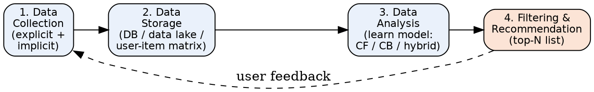
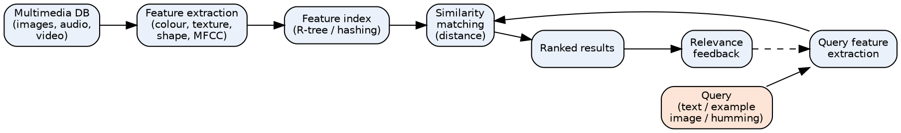
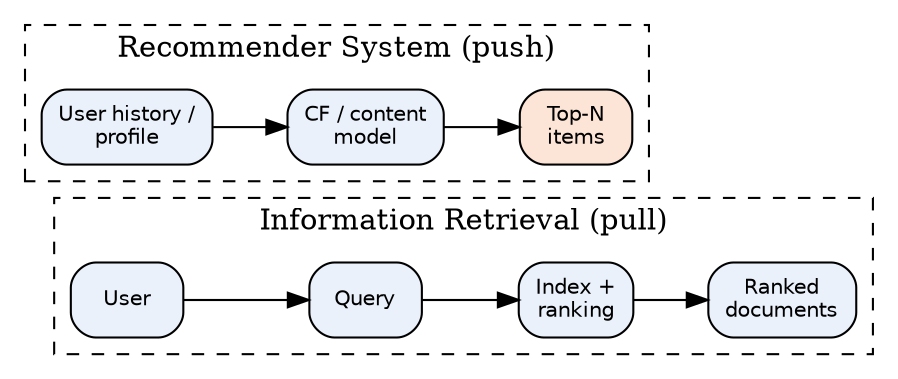
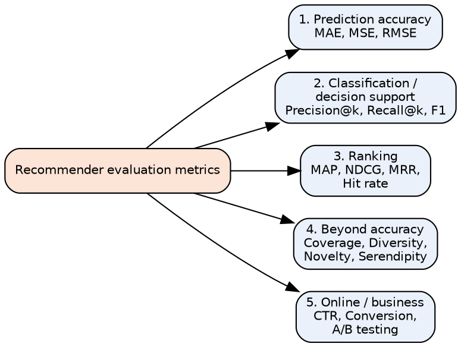
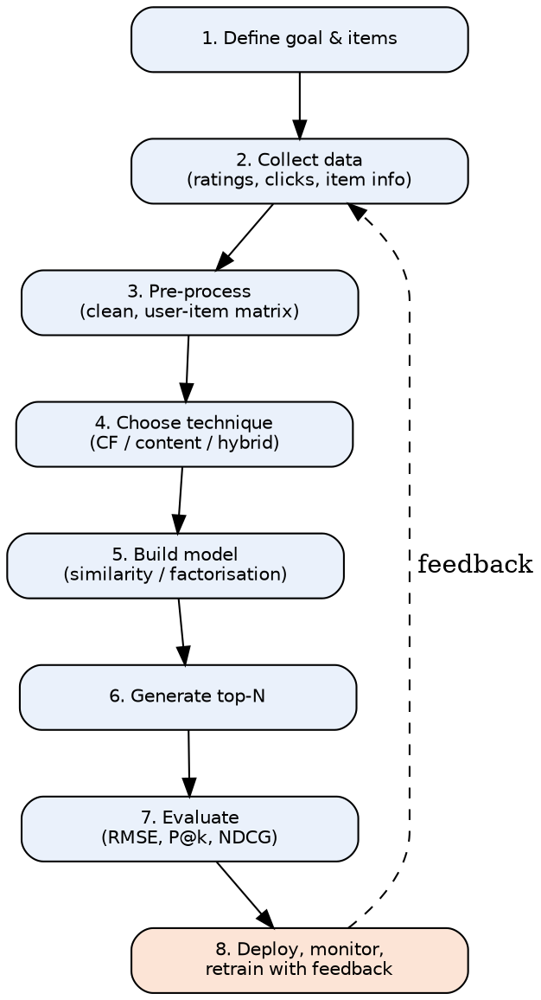

# Unit Snapshot

| No. | Question | Max Marks | Years Asked | Importance |
|---|---|---|---|---|
| 4.1 | Four phases of recommender system | 9 | N23, M24, N24, N25 | ★★★ |
| 4.2 | Multimedia Information Retrieval / multimedia IR models | 9 | N23 (×2), M24, N24, N25 | ★★★ |
| 4.3 | Difference between information retrieval and recommender system | 9 | N23, N24, N25 | ★★★ |
| 4.4 | Evaluation metrics for recommender systems | 10 | M24, N24, N25 | ★★★ |
| 4.5 | Steps to build a recommender system with an example | 10 | M24 | ★ (high marks) |

N23 = Nov–Dec 2023, M24 = May–Jun 2024, N24 = Nov–Dec 2024, N25 = Nov–Dec 2025. Source file for all citations: *Textbooks/IR Sem7.pdf* ("PDF p." = page of the PDF, "§" = section number in the notes).

# Must-Do First (★★★)

1. **4.1** Four phases of recommender system
2. **4.2** Multimedia IR and its models
3. **4.3** IR vs recommender system
4. **4.4** Recommender evaluation metrics

**Exam strategy:** Since N24, Q7 = 4.2 + 4.1 and Q8 = 4.4 + 4.3 (9 marks each). All four ★★★ answers cover this whole unit. Answers are written for 11–12 marks, so they are the longest in the set — write the diagram + table first, then the points.

# Full Answers

## 4.1 What are the four phases of recommender system? ★★★

**Write for:** 11 marks (asked max 9) · **Asked in:** N23 Q7b [9], M24 Q7b [8], N24 Q7b [9], N25 Q7b [9] · **Source:** Recommender basics in IR Sem7.pdf, PDF p.53–57 (§6.2 Recommendation Systems, §6.2.1 Collaborative Filtering, §6.2.2 Content Based, §6.3 Knowledge Based). The "four phases" list itself: ⚠ Not found in your materials — standard textbook answer.

### Definition
A **recommender system (RS)** is an information-filtering system that **predicts a user's preference (rating)** for items and **suggests the most relevant items** (movies, products, news) **without an explicit query**. E.g. Netflix, Amazon, YouTube.

### The four phases

**Phase 1 — Data Collection (Information collection)**
- Gathers information about **users, items and interactions** to build the **user profile**.
- **Explicit feedback:** ratings (1–5 stars), likes, reviews, surveys.
- **Implicit feedback:** clicks, views, purchase history, watch time, search queries, dwell time.
- **Item data:** title, genre, description, price (for content-based); **context:** time, location, device.
- Problem: **cold start** for new users/items with no data.

**Phase 2 — Data Storage**
- Collected data is stored so it can be analysed efficiently: **relational DB** (structured ratings), **NoSQL / data lake** (logs, clickstreams), **user–item rating matrix**.
- Choice of storage depends on **volume, velocity and type** of data; the matrix is usually **sparse** (users rate few items).

**Phase 3 — Data Analysis (Learning phase)**
- A learning algorithm finds **patterns and similarities** and builds a model:
  - **Collaborative filtering (CF):** "users similar to you liked this" — user-based / item-based similarity (cosine, Pearson), **matrix factorisation**.
  - **Content-based filtering (CB):** match **item features** with the user's profile (TF-IDF of descriptions).
  - **Knowledge-based:** rules/constraints from the user's explicit requirements.
  - **Hybrid:** combination (Netflix).
- Analysis can be **real-time**, **near-real-time** or **batch**.

**Phase 4 — Data Filtering & Recommendation (Prediction phase)**
- The model **predicts ratings/scores** for unseen items, **filters** already-seen or unavailable items, **ranks** them and shows the **top-N recommendations**.
- Filtering methods: **content-based, collaborative, hybrid**; predicted rating e.g. $\hat r_{u,i} = \bar r_u + \dfrac{\sum_v sim(u,v)(r_{v,i} - \bar r_v)}{\sum_v |sim(u,v)|}$
- User reactions are **fed back** to Phase 1 → system keeps improving.

### Component explanation (diagram)
- **Collection** → input signals; **Storage** → organised data; **Analysis** → trained model; **Filtering & recommendation** → output list; **dashed arrow** → continuous feedback loop.

### Example (Netflix)
1. Collect: you rate *Inception* 5★, watch 3 sci-fi films. 2. Store: ratings in user–item matrix, logs in data lake. 3. Analyse: users similar to you also liked *Interstellar*. 4. Recommend: *Interstellar* appears in "Because you watched Inception".

### Applications
E-commerce (Amazon), OTT (Netflix, Hotstar), music (Spotify), news feeds, social media friend suggestions, e-learning course suggestions.

### Conclusion
A recommender works in four phases — **Collect → Store → Analyse → Filter/Recommend** — with user feedback looping back to improve future recommendations.

**Memory trick:** **"CSAF"** → "**C**an **S**omeone **A**dvise **F**ilms?" = **C**ollection, **S**torage, **A**nalysis, **F**iltering. Mention **explicit vs implicit** feedback — examiners expect it.

## 4.2 Multimedia Information Retrieval / Explain multimedia IR models. ★★★

**Write for:** 11 marks (asked max 9) · **Asked in:** N23 Q7a "Explain multimedia IR models?" [9] and Q8a "Multimedia Information Retrieval" [9], M24 Q8a [8], N24 Q7a [9], N25 Q7a [9] · **Source:** IR Sem7.pdf, PDF p.48–53 (§6.1 Multimedia Information Retrieval — key components; §6.1.1 Spoken Language Audio Retrieval, §6.1.2 Non-Speech Audio Retrieval, §6.1.3 Graph Retrieval, §6.1.4 Imagery Retrieval, §6.1.5 Video Retrieval with colour-histogram Python example). Model classification (text-based / content-based / feature-vector, probabilistic, MPEG-7): partly standard textbook.

### Definition
**Multimedia Information Retrieval (MIR)** deals with the **retrieval, organisation and analysis of multimedia data** — **text, images, audio, video, graphics** — so that users can **search, access and analyse** multimedia content efficiently (notes). Used by search engines, recommendation systems and digital libraries.

### 1. Key components of MIR (notes)
1. **Data representation:** images/videos as **feature vectors or histograms**; audio as **spectrograms** or **MFCCs** (Mel-Frequency Cepstral Coefficients).
2. **Indexing and retrieval:** inverted files, **tree-based indexes (R-tree, k-d tree)**, **hashing** for fast similarity search.
3. **Content-based retrieval:** finds items similar in **visual/audio features**, not metadata.
4. **Text-based retrieval:** uses **keywords, captions, tags, metadata**.
5. **Multimedia analysis:** object recognition, speech recognition, emotion and scene detection.
6. **Relevance feedback:** user marks relevant/irrelevant results to refine search.
7. **Evaluation metrics:** precision, recall, F-measure.

### 2. Multimedia IR models
**(a) Text-based (metadata / annotation) model**
- Multimedia objects described by **text** (file name, caption, tags, surrounding web text); then classic IR (Boolean, vector, probabilistic) is applied.
- Simple and fast, but needs **manual annotation**; subjective and incomplete.

**(b) Content-based (CBMR) model — feature-vector model**
- Extract **low-level features** automatically: **colour** (histogram), **texture** (Gabor, GLCM), **shape** (edges, contours), **motion** (video), **pitch/rhythm/MFCC** (audio).
- Each object = **point in a feature space**; query by example (**QBE**) or sketch.
- Similarity = **Euclidean distance** $d(\vec q,\vec o) = \sqrt{\sum_i (q_i - o_i)^2}$ or **cosine similarity**; results ranked by similarity (k-NN search).

**(c) Probabilistic / learning-based model**
- Estimates **P(relevant | features)** using Bayesian or **deep learning** models (CNN embeddings for images, speech-to-text for audio); bridges the **semantic gap**.

**(d) Structured / data model (e.g. MPEG-7)**
- Standard **descriptors & description schemes** for multimedia content (colour, shape, motion, audio descriptors) + **query languages** supporting attribute and similarity predicates.

- **Multimedia DB:** stored media objects. **Feature extraction:** converts each object into a numeric descriptor (offline).
- **Feature index:** multidimensional index for fast search.
- **Query & query features:** user query converted to the same feature space.
- **Similarity matching:** computes distance between query and stored features. **Ranked results** → **relevance feedback** refines the query.

### 3. Types of multimedia retrieval (notes §6.1.1–6.1.5)
| Type | How it works | Example |
|---|---|---|
| **Spoken language audio** | Speech recognition (ASR) → text → index; keyword spotting | Podcast / lecture search |
| **Non-speech audio** | Acoustic features (MFCC, pitch, rhythm), audio fingerprinting | Shazam, query-by-humming |
| **Graph retrieval** | Match graph structure/sub-graphs (nodes, edges) | Chemical structures, knowledge graphs |
| **Imagery (image) retrieval** | Colour, texture, shape features; CNN embeddings | Google Lens, reverse image search |
| **Video retrieval** | Shot/scene detection, key frames, motion, audio + captions | YouTube search, CCTV analysis |

### 4. Challenges
**Semantic gap** (low-level features ≠ high-level meaning), high dimensionality, huge storage, subjectivity of similarity, multimodal fusion, copyright.

### Example
User uploads a photo of a red rose → system computes its **colour histogram** → finds images with closest histograms (Euclidean distance) → returns top-10 similar flower images; the notes' Python example does the same for **videos** using OpenCV colour histograms + cosine similarity.

### Conclusion
MIR retrieves non-text media using **text-based** and **content-based (feature-vector)** models plus **probabilistic/deep models**; it covers **speech, audio, graph, image and video retrieval**, with the **semantic gap** as the main challenge.

**Memory trick:** Types = **"SNGIV"** → "**S**ome **N**ice **G**irls **I**n **V**ideos" = **S**poken audio, **N**on-speech audio, **G**raph, **I**mage, **V**ideo. Models = **T-C-P-S**: **T**ext, **C**ontent, **P**robabilistic, **S**tructured (MPEG-7).

## 4.3 What is the difference between information retrieval and recommender system? ★★★

**Write for:** 11 marks (asked max 9) · **Asked in:** N23 Q8b, N24 Q8b, N25 Q8b (all 9 marks) · **Source:** ⚠ Not found in your materials (no comparison in notes). Standard textbook answer; definitions consistent with IR Sem7.pdf, PDF p.53 (§6.2 Recommendation Systems).

### Definitions
- **Information Retrieval (IR) system:** finds documents **relevant to an explicit user query** from a large collection and returns a **ranked list** (e.g. Google Search). It is **pull-based** — the user asks.
- **Recommender System (RS):** **predicts and suggests items** a user may like **without an explicit query**, using the user's **past behaviour, preferences and similar users** (e.g. Netflix). It is **push-based** — the system offers.

### Difference table

| No. | Basis | Information Retrieval | Recommender System |
|---|---|---|---|
| 1 | Input | **Explicit query** (keywords) | **User profile / history**, no query needed |
| 2 | Interaction mode | **Pull** — user actively searches | **Push** — system proactively suggests |
| 3 | Goal | Satisfy a **specific, current information need** | Discover items matching **long-term interests/taste** |
| 4 | Personalisation | Same query → mostly **same results** for all users | **Highly personalised** — different users get different lists |
| 5 | Core technique | Indexing, **TF-IDF, BM25, PageRank**, query–document matching | **Collaborative filtering, content-based, hybrid**, matrix factorisation |
| 6 | Data used | **Document content** (text, links) | **User–item interactions** (ratings, clicks, purchases) + item features |
| 7 | Relevance basis | **Topical relevance** to the query | **User preference / utility**, predicted rating |
| 8 | Output | **Ranked list of documents** | **Top-N items** or predicted ratings |
| 9 | Key problems | Query ambiguity, vocabulary mismatch | **Cold start, data sparsity**, filter bubble |
| 10 | Evaluation | **Precision, recall, MAP, NDCG** on relevance judgments | **RMSE, MAE**, precision@k, recall@k, coverage, diversity, novelty, CTR |
| 11 | Items | Documents / web pages | Products, movies, songs, news, friends |
| 12 | Examples | Google, Bing, library catalogue (OPAC) | Netflix, Amazon "customers also bought", YouTube, Spotify |

- **IR path:** user writes a query → index & ranking function → ranked documents.
- **RS path:** no query; the user's history and similar users feed the model → personalised top-N items.

### Similarities / overlap
- Both **filter information overload** and produce **ranked outputs**; both use **similarity measures** (cosine) and **relevance feedback**.
- **Content-based recommendation** uses IR techniques (TF-IDF profiles); modern search engines add **personalisation** (recommendation ideas) — e.g. YouTube combines search and recommendations.

### Example
Typing "best thriller movies" on Google = **IR**. Netflix home page showing *Mindhunter* because you watched *Narcos* = **RS**.

### Conclusion
IR answers an **explicit query** with **relevant documents (pull)**; a recommender **predicts preferences** and **pushes personalised items** without a query — they complement each other.

**Memory trick:** "**IR = Ask & Get (Pull); RS = Get without Asking (Push)**". Write at least **10 rows** for 9-mark versions.

## 4.4 What are the different evaluation metrics for recommender system? ★★★

**Write for:** 12 marks (asked max 10) · **Asked in:** M24 Q8b [10], N24 Q8a [9], N25 Q8a [9] · **Source:** ⚠ Not found in your materials (notes give precision/recall/F-measure only for MIR, PDF p.48, and for search, PDF p.42). Standard textbook answer.

### Definition
**Evaluation metrics** measure **how good the recommendations are** — how accurately ratings are predicted, how relevant and well-ranked the top-N list is, and whether recommendations are **diverse, novel and useful** for the business.

### 1. Prediction (rating) accuracy metrics
- **MAE (Mean Absolute Error):** $MAE = \dfrac{1}{N}\sum_{(u,i)} |r_{u,i} - \hat r_{u,i}|$
- **RMSE (Root Mean Squared Error):** $RMSE = \sqrt{\dfrac{1}{N}\sum_{(u,i)} (r_{u,i} - \hat r_{u,i})^2}$ — penalises **large errors** more (used in the **Netflix Prize**).
- $r_{u,i}$ = actual rating of user u for item i, $\hat r_{u,i}$ = predicted rating, N = number of test ratings. **Lower is better.**

### 2. Classification (decision-support) metrics for top-N lists
- **Precision@k** = $\dfrac{\text{relevant items in top } k}{k}$ — how many recommended items are useful.
- **Recall@k** = $\dfrac{\text{relevant items in top } k}{\text{total relevant items for the user}}$ — how many liked items were found.
- **F1@k** = $\dfrac{2 \cdot P \cdot R}{P + R}$.

### 3. Ranking metrics (position matters)
- **MAP (Mean Average Precision):** mean over users of the average of precision values at each relevant position.
- **NDCG@k:** $DCG_k = \sum_{i=1}^{k}\dfrac{rel_i}{\log_2(i+1)}$, $NDCG_k = \dfrac{DCG_k}{IDCG_k}$ (IDCG = DCG of ideal ordering) — rewards relevant items at **top positions**; supports graded relevance.
- **MRR (Mean Reciprocal Rank):** mean of $1/\text{rank of first relevant item}$.
- **Hit rate@k:** fraction of users with at least one relevant item in top-k.

### 4. Beyond-accuracy metrics
- **Coverage:** % of catalogue items the system can recommend (catalogue coverage) or % of users who get recommendations.
- **Diversity:** how **different** the items in one list are (1 − average pairwise similarity).
- **Novelty:** recommending items the user **did not already know** (less popular items).
- **Serendipity:** **surprising yet relevant** recommendations.
- **Personalisation / scalability / response time.**

### 5. Online (business) metrics
- **CTR (Click-Through Rate)** = clicks ÷ impressions; **conversion rate**, revenue, watch time, retention — measured using **A/B testing** with real users. Also **user studies** (satisfaction surveys).

### Worked example
Actual ratings (3, 5, 4), predicted (4, 4, 4):
- MAE = (1 + 1 + 0)/3 = **0.67**; RMSE = $\sqrt{(1+1+0)/3}$ = **0.82**.

Top-5 list [A, B, C, D, E]; relevant = {A, C, F}:
- Precision@5 = 2/5 = **0.4**; Recall@5 = 2/3 = **0.67**; F1 = 2(0.4)(0.67)/(1.07) = **0.5**.
- MRR = 1/1 = **1** (A is relevant at rank 1).
- DCG = 1/log₂2 + 1/log₂4 = 1 + 0.5 = 1.5; IDCG (relevant at ranks 1, 2, 3) = 1 + 0.63 + 0.5 = 2.13 → **NDCG = 0.70**.

### Offline vs online evaluation
| Offline | Online |
|---|---|
| Historical data split into train/test | Live users, A/B test |
| MAE, RMSE, Precision@k, NDCG | CTR, conversion, retention |
| Cheap, fast, repeatable | Real impact, costly, slower |

### Conclusion
Recommenders are evaluated by **accuracy (MAE, RMSE)**, **top-N relevance (precision, recall, F1)**, **ranking quality (MAP, NDCG, MRR)**, **beyond-accuracy (coverage, diversity, novelty, serendipity)** and **online business metrics (CTR, A/B testing)**.

**Memory trick:** "**A-C-R-B-O**" → "**A** **C**ar **R**uns **B**etter **O**nline": **A**ccuracy, **C**lassification, **R**anking, **B**eyond-accuracy, **O**nline. RMSE > MAE when big errors exist — a common viva question.

## 4.5 Outline the steps to build a recommender system with an example. ★

**Write for:** 12 marks (asked max 10) · **Asked in:** M24 Q7a [10] · **Source:** IR Sem7.pdf, PDF p.53–57 (§6.2.1 Collaborative Filtering — user–item rating matrix, similar users; §6.2.2 Content Based Recommendation — CountVectorizer / document-term matrix, cosine similarity; §6.3 Knowledge Based Recommendation), PDF p.61 (case study: collaborative filtering on a dataset). Step list organised as a standard textbook pipeline.

### Definition
**Building a recommender system** means creating a pipeline that **collects user–item data, learns user preferences and generates personalised top-N suggestions**, then evaluates and improves them.

### Steps

1. **Define the problem & goal:** what to recommend (movies), to whom, which success metric (accuracy, CTR).
2. **Collect data:** **explicit** (ratings, reviews) and **implicit** (clicks, views, purchases) feedback; **item metadata** (genre, cast, description); user demographics.
3. **Pre-process data:** remove noise/duplicates, handle missing values, normalise ratings (mean-centring), build the **user–item rating matrix** (sparse) or **TF-IDF / CountVectorizer** item-feature matrix.
4. **Choose technique:**
   - **Collaborative filtering** (user-based / item-based, matrix factorisation — SVD/ALS) — uses ratings of similar users.
   - **Content-based** — matches item features with user profile.
   - **Knowledge-based** — rules/constraints from user needs (e.g. budget).
   - **Hybrid** — combines them to solve **cold start** and sparsity.
5. **Build the model:** compute **similarity** (cosine, Pearson) between users/items or learn latent factors; predict unknown ratings.
6. **Generate recommendations:** predict scores for unseen items, **filter** seen/unavailable items, **rank** and return **top-N**.
7. **Evaluate:** split train/test → **MAE/RMSE, Precision@k, Recall@k, NDCG**; online **A/B testing (CTR)**.
8. **Deploy & improve:** serve via API, monitor, collect new feedback, **retrain** periodically.

### Worked example — user-based collaborative filtering (movies)

| User | M1 | M2 | M3 | M4 |
|---|---|---|---|---|
| Alice | 5 | 3 | **?** | 1 |
| Bob | 4 | 3 | 4 | 1 |
| Carol | 1 | 1 | 5 | 5 |

**Goal:** predict Alice's rating for M3.

**Step A — cosine similarity on co-rated items (M1, M2, M4):**
- sim(Alice, Bob) = $\dfrac{5\cdot4 + 3\cdot3 + 1\cdot1}{\sqrt{35}\,\sqrt{26}} = \dfrac{30}{30.17} = 0.99$
- sim(Alice, Carol) = $\dfrac{5\cdot1 + 3\cdot1 + 1\cdot5}{\sqrt{35}\,\sqrt{27}} = \dfrac{13}{30.74} = 0.42$

**Step B — weighted prediction:**
$$\hat r_{Alice,M3} = \frac{\sum_v sim(Alice,v)\, r_{v,M3}}{\sum_v sim(Alice,v)} = \frac{0.99 \times 4 + 0.42 \times 5}{0.99 + 0.42} = \frac{6.06}{1.41} \approx 4.3$$

**Step C — recommend:** predicted rating 4.3 (high) → **recommend M3 to Alice**. Bob (most similar) liked M3, so the result makes sense.

**Step D — evaluate:** hide some known ratings, predict them, compute RMSE; check Precision@k of the top-N list.

### Content-based alternative (notes)
Item descriptions → **CountVectorizer/TF-IDF** → **cosine similarity matrix** between movies → recommend movies most similar to those the user liked.

### Challenges
**Cold start**, **sparsity**, scalability, **popularity bias / filter bubble**, privacy, changing user tastes.

### Conclusion
A recommender is built by **defining the goal → collecting & preparing data → choosing CF/content/hybrid → building the similarity model → generating top-N → evaluating → deploying with feedback**; user-based CF with cosine similarity is the simplest exam example.

**Memory trick:** "**G-C-P-T-M-R-E-D**" → "**G**ood **C**ooks **P**repare **T**asty **M**eals, **R**eally **E**xcellent **D**ishes": **G**oal, **C**ollect, **P**re-process, **T**echnique, **M**odel, **R**ecommend, **E**valuate, **D**eploy.

# Last-Minute Revision Sheet — Unit 4

| Topic | Key point to write |
|---|---|
| Recommender system | Predicts preference & suggests items **without a query** (push) |
| Four phases | **CSAF**: Collection (explicit/implicit) → Storage → Analysis (CF/CB/hybrid) → Filtering & recommendation |
| Feedback types | Explicit (ratings, reviews) vs implicit (clicks, views, purchases) |
| Techniques | Collaborative (user/item based, matrix factorisation), Content-based, Knowledge-based, Hybrid |
| CF prediction | $\hat r=\sum sim\cdot r/\sum sim$; cosine / Pearson similarity |
| Problems | Cold start, sparsity, scalability, filter bubble |
| MIR definition | Retrieval of text, image, audio, video, graphs |
| MIR components | Representation, indexing, content-based, text-based, analysis, relevance feedback, evaluation |
| MIR models | Text-based, content-based feature vector (colour/texture/shape/MFCC), probabilistic/deep, MPEG-7 |
| MIR types | SNGIV: Spoken audio, Non-speech audio, Graph, Image, Video |
| Semantic gap | Low-level features ≠ high-level meaning |
| IR vs RS | Query vs profile; pull vs push; same vs personalised results; precision/MAP vs RMSE/CTR |
| Accuracy metrics | MAE = mean abs error; RMSE = √mean squared error |
| Top-N / ranking | Precision@k, Recall@k, F1, MAP, NDCG = DCG/IDCG, MRR, hit rate |
| Beyond accuracy | Coverage, diversity, novelty, serendipity; online: CTR, A/B test |
| Build steps | Goal, Collect, Pre-process, Technique, Model, Recommend, Evaluate, Deploy |

**Mnemonics:** CSAF (phases) · SNGIV + T-C-P-S (MIR) · "Pull vs Push" (IR vs RS) · A-C-R-B-O (metrics) · G-C-P-T-M-R-E-D (build steps).

# Assumptions & Gaps

- **Unit mapping:** Q7/Q8 of every paper mapped to Unit 4 = syllabus Unit VI (IR Applications).
- **⚠ Not found in your materials (standard textbook answers):** 4.1 the "four phases" list (several textbooks give different lists; the widely used *Collection–Storage–Analysis–Filtering* version is used; an alternative 3-phase version is *Information collection → Learning → Prediction/Recommendation*, which maps onto the same answer); 4.3 IR vs RS comparison; 4.4 recommender evaluation metrics. Model classification in 4.2 is partly standard.
- **4.2** merges "Explain multimedia IR models" and "Multimedia Information Retrieval" (N23 printed both in one paper). The answer covers both definition/components and models.
- **4.5** worked example data were made up by me for illustration (not from the notes).
- Citations give PDF page numbers of *IR Sem7.pdf* (two printed pages per PDF page) and section numbers printed in the notes.
